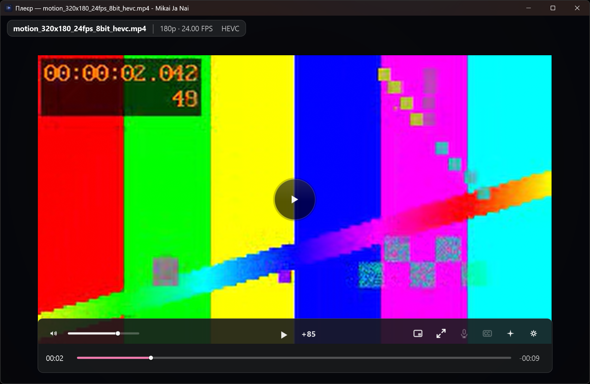
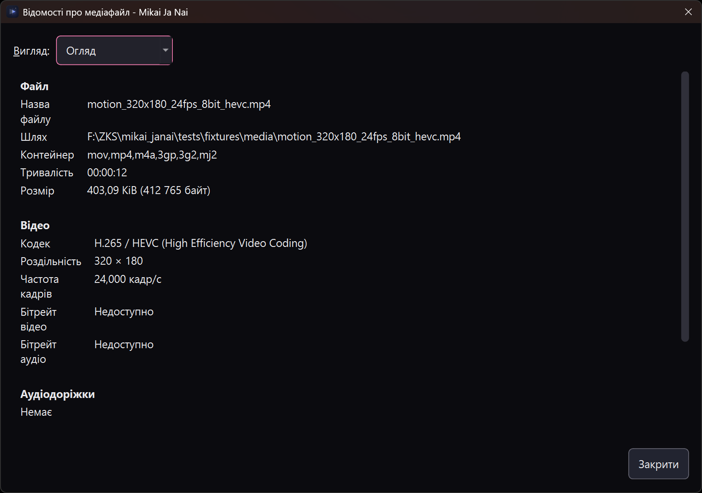
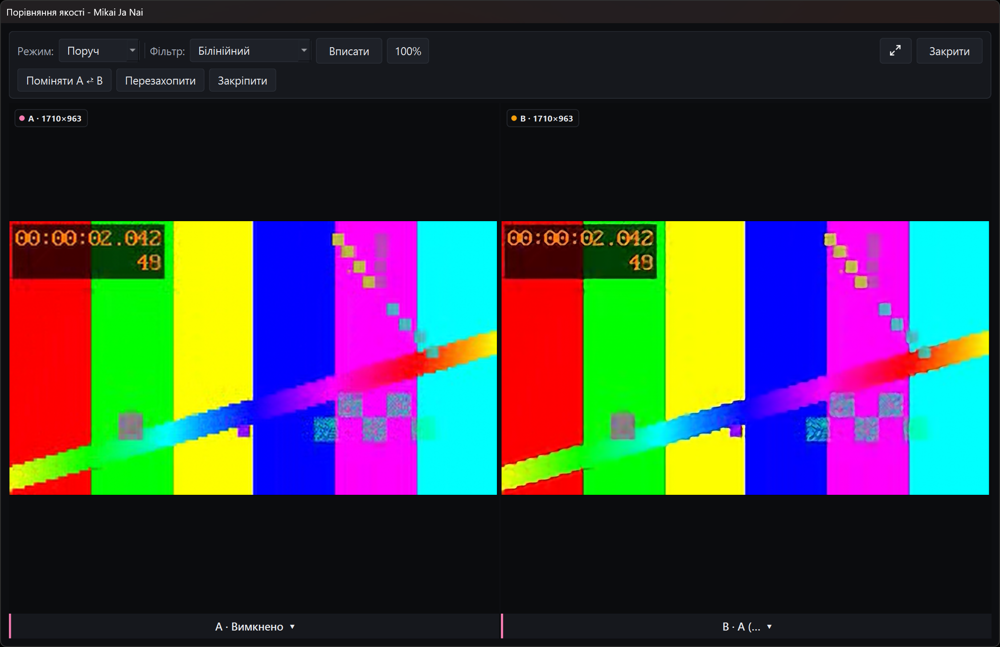

# Player guide

This guide covers the player window, catalogue episodes, local videos and URLs. Catalogue playback is resolved through the selected provider; local playback is a separate file-player workflow. For processing and component setup, see the [processing guide](processing-guide.md).

## Start playback

### Catalogue episode

1. Browse or search the catalogue and open a title.
2. Select an episode from its release/episode list. Clicking an episode button selects it and opens the player directly; the title panel’s **Watch** button plays the episode that is already selected, and becomes **Continue** when a saved position exists. The provider supplies the stream; provider availability and extraction behavior can vary.
3. Use the player’s **Audio** and **Subtitles** controls (or **T** and **C**) to choose among the title’s available provider variants. These change the selected stream variant, not an embedded track in one local file.

The catalogue owns the episode list. Open it with **S**, choose an episode to switch, or use the previous/next episode controls when available. Those controls are shown only when another episode exists in the playlist. The title-page episode context menu can **Mark as watched** or **Unwatch** the episode, and **Watch all previous** or **Unwatch all previous** in the provider’s catalogue order.

On the title page, episode range buttons wrap in narrow layouts rather than pushing the page sideways. First/last navigation and direct page entry stay available.

### Local video or URL

From the main window, choose **Open video → Video file…** and select a file. The picker lists common video extensions and **All files**. **Open video → Video URL…** accepts a video or stream URL. You can also drag a video file with a recognised extension onto the main window to open a standalone player, or onto an existing player to replace its media.

The player does not move or delete a local source file. Local media can have embedded audio/subtitle tracks and exact-match sidecars; unrelated files in the containing folder are not indiscriminately loaded. Use **Audio** and **Subtitles** to choose available tracks; the local subtitle menu includes **Off**. Track rows may include title, language, codec, channels and flags such as external, forced or default. A menu may report that no alternate audio or no subtitles are available when the source has no choices.

*A local file paused mid-playback, original pipeline, no processing preset. The pictured clip is a synthetic project-generated 12-second 320×180 HEVC colour-pattern fixture, not a provider stream or anime footage.*

Catalogue variant selection and local track selection are different operations: a catalogue choice selects a provider variant, while a local-file choice selects a track in the active media.

## Transport and timeline

- **Space** toggles play/pause. The player dock also has a play/pause control.
- The timeline shows playback position and remaining time when duration is known. Drag/scrub it to seek; the final pointer position on left-button release selects the target, even if the last movement event was elsewhere.
- Hover over a seekable video’s timeline to preview a frame and timestamp without moving playback. Repeated movement over the same preview position keeps the pending decode; the last decoded picture can remain visible while the next one loads. The card belongs to the bar: moving the pointer off the timeline dismisses it immediately, so it never lingers over the picture. During a drag, the card shows the time without decoding a frame. Unseekable or unavailable sources show a reason instead.
- MoonAnime **Opening**, **Ending**, **Mixed opening**, **Mixed ending** and **Recap** ranges are tinted with the app accent; the hover card names each range under the pointer.
- When MoonAnime supplies skip markers, **Skip Opening**, **Skip Ending** and the other segment offers appear above the right side of the player dock while that range is playing. Select one to seek to its end; overlapping segments remain separate offers. Markers depend on the selected episode and provider.
- The separate **+85** control advances by 85 seconds, bounded by a known duration.
- **← / →** seeks backward/forward by 5 seconds when duration is known. Steps use the playback core's current position, so rapid presses are not shortened by a delayed progress update. If duration is unknown, those keys request the previous/next episode instead.
- **↑ / ↓** changes volume by 10 percentage points; **M** toggles mute. Scroll over the volume slider or speaker to change volume by 5 percentage points per wheel notch; this also works in PiP.
- **T / C / Q** open Audio, Subtitles, and Quality and speed, respectively. Menus can be navigated with **↑ / ↓** (or **← / →**), confirmed with **Enter**, and closed with **Esc**.

In fullscreen, the dock and its overlays hide after about 2.5 seconds without pointer movement. That idle hide is deferred while the pointer rests on the timeline, the volume control or the dock, while an overlay is open, or during a drag. The next movement brings the chrome back. In windowed mode the dock stays visible.

The **Q** flyout is a card, not a menu. It holds a **SPEED** slider from 0.25x to 2.0x with preset rows (**0.5x Slow**, **1.0x Normal**, **1.2x Slightly faster**, **1.5x Fast**, **1.7x Very fast**, **2.0x Double speed**), a **QUALITY** list when the provider offers resolutions, the **SCALING** quick modes, and **Set as default video player…**. Dragging the slider changes speed while it moves; choosing a speed, quality or scaling row closes the flyout. **Set as default video player…** registers the app as an available video player and opens the platform's default-applications settings so you can choose it; it never changes your defaults itself. If that settings page cannot be opened, a warning says where to pick the app instead.

## Keyboard, mouse and window navigation

The player’s **?** or **/** shortcut overlay lists the available keys:

| Key | Action |
|---|---|
| `Space` | Play / pause |
| `F` or `F11` | Fullscreen / windowed |
| `M` | Mute / unmute |
| `S` | Episode list |
| `T` | Choose audio track/variant |
| `C` | Choose subtitle track/variant |
| `Q` | Quality and speed |
| `←` / `→` | Seek −/+ 5 seconds when duration is known; otherwise request previous/next episode |
| `↑` / `↓` | Volume ±10% |
| `Esc` | Dismiss the topmost open panel/overlay; when none remain, close the player |

A left-button double-click on the player picture also toggles fullscreen/windowed. **Esc** is a sequence, not an immediate close: open panels are dismissed first. The picture context menu provides **Copy frame**, **Compare quality**, **Copy link**, **Open containing folder** when applicable, **Media information** for local media, **Keyboard shortcuts**, and **Exit**.

## Episode resume and watch state

Catalogue episode progress is saved locally, not synchronized to the Mikai service. Playback starts at the beginning; when a saved position is available, the duration is known and that position is more than five seconds before the end, the player offers **Continue** or **Start over**. Continue seeks to the saved point, clamped to five seconds before the end. Start over clears the saved offset. Dismissing the prompt leaves the offset available for a later attempt.

Progress updates below 30 seconds do not create or replace a resume point. At 90% of a known episode duration, the episode is marked watched; an episode that finishes also becomes watched. Finishing clears its saved offset. On the title page, an unfinished saved position can appear as a progress bar and elapsed/total text, and the action changes to **Continue**. The title-page **Watched** control can manually mark that episode watched or unwatched. These thresholds describe catalogue episode history, not a local-file resume promise.

## Window controls

In a windowed or fullscreen frameless player the top-right corner holds **Minimize** and **Exit** controls. The exit button has a red fill, and both controls follow the application corner-radius setting. Dragging the title bar moves the window; **Esc** still exits.

## Picture-in-picture

Choose the player’s PiP control (**Picture in picture**) to open a frameless, always-on-top floating player; the expand control (**Return to the window**) goes back to the main player window. The float uses its own playback surface for the same stream, while the original surface is paused. PiP carries its own play/pause, volume slider and mute controls, plus its own clock.

In PiP, **← / →** seeks backward/forward by 10 seconds, **Space** toggles play/pause and **Esc** closes the float. The seek steps use the float's own playback clock and preserve its paused state.

PiP behavior is window-manager dependent. On Wayland, the compositor controls interactive movement/resizing and may not honor always-on-top. Closing the float closes the player rather than silently leaving hidden playback behind.

## HDR and media badges

In **Settings → Application → Access → HDR playback**, choose **Auto (recommended)**, **Stable - no per-frame adaptation**, or **Vivid - Mobius curve**. Saved tone-mapping changes reach a running player shortly afterward. This controls how HDR is mapped to the display; it is separate from Native enhancement.

The title details sidebar links its format, status, studio, genres and tags to catalogue filters. Its poster opens the cover viewer, its titles can be copied, and **Episodes** jumps to the episode list. Other metadata remains selectable text.

**Video scaling**, on the card below, offers **Native (fit to window)**, **Fill (crop edges)**, **Stretch**, **16:9**, **4:3** and **Original size (1:1)**, followed by a zoom percentage and upscaler/downscaler choices. The **SCALING** section of the player settings flyout repeats the first five modes as quick switches. On the settings card, **Stretch** disables the zoom field because it ignores the percentage. A running player adopts a saved change without a restart, and a paused picture redraws once the writes complete. PiP follows the same policy; Compare holds Fit with no zoom while it owns the picture. **Original size (1:1)** and the scalers remain Settings-only choices.

While an engine build holds playback, the player shows **Preparing enhancement — playback paused** instead of an unexplained frozen picture. Closing the player during that build shows **Finishing enhancement…** if the stop takes more than a third of a second, and does not keep the window up for the old eleven-second settle. A source change keeps the last presented picture until the new source produces a frame; that is a visual hold, not proof that playback is still advancing.

The separate **Native enhancement for HDR** checkbox permits processing that is normally skipped on HDR sources. The required stages use 8-bit NV12; enabling the override does not convert the source to SDR and may reduce HDR image quality. Unknown transfer metadata is not proof that a source is SDR, so this override should not be described as enabling processing for unknown sources.

Player badges such as **HDR**, **DV**, **ATMOS**, and the codec name reflect metadata reported by the source. A missing badge means the container did not report that metadata; a badge does not verify the display’s output. Processing chains are not guaranteed to preserve HDR; see the [processing guide](processing-guide.md) for processing limitations.

## Enhancement controls and preset shortcuts

The spark control on the player dock (**Open enhancements**) opens the **ENHANCEMENTS** menu. It lists the Anime4K presets, including **Disabled**; an **AnimeJaNai ›** branch with **Off**, **Spatial models**, **RIFE models** and **Backend**; an **Upscalers ›** branch listing every optional downloaded graph with its stored state; and the Native processing rows when a Native runtime is loaded. A choice applies to the running picture without a separate confirm step. While an AnimeJaNai preset is selected, the player footer names it with the backend in use (`TRT`, `TRT-RTX` or `DML`) and, once the source is known, the output size or the target frame rate.

An **Upscalers ›** row that is installed applies that graph as a one-step AnimeJaNai chain with the graph's own factor (4× for the Real-ESRGAN pair, 2× for HFA2kCompact); a row that is not installed opens **Settings → Playback → Upscalers** instead of pretending it can run. The footer chip names the selection (`TRT · 2x HFA2kCompact (fp32) · 2×`) once the plan is configured. Selecting a graph that needs an engine build pauses the picture while it builds.

**Backend** offers **TensorRT**, **TensorRT for RTX** and **DirectML**. On Windows all three are listed; TensorRT for RTX is a separate runtime that builds its engines in-process. On Linux, TensorRT for RTX is listed but unavailable by name, because no Linux RTX runtime is published, and the request is never redirected to another backend. Choosing a backend installs nothing and verifies nothing.

When playback fails, the status strip names the reason and offers **Retry**. When an enhancement fails, the strip keeps its remedies up until you act: **Prepare** and **Providers** for a Native failure, **Settings** for an AnimeJaNai failure, and **Original** or **Turn off AnimeJaNai** to return to the unprocessed picture. Component installation, verification and benchmarks stay in Settings; see the [processing guide](processing-guide.md).

Anime4K presets can also be bound to single keys under **Settings → Application → Keyboard shortcuts**. A bound preset key applies that preset while the player window is active; the player reads its bindings when the window opens, so a new binding applies to the next player window. The player's own keys are reserved, and one combination can belong to only one preset, so a refused binding is explained on the settings page; see the [settings guide](settings-guide.md).

## Subtitle timing

The subtitle selector ends with a **Subtitle delay** group: **0.1 s earlier**, **0.1 s later** and **Reset delay**, with the current value in the group heading. It drives mpv's `sub-delay`, so it moves whatever track is showing — embedded, from disk, or downloaded — and the value lasts for the rest of the player session. Reset is disabled while the delay is already zero.

## Subtitles from OpenSubtitles

Right-click the picture → **Subtitles ›** offers **From disk…** for local or network video and **OpenSubtitles…**. The second opens a search dialog seeded with the current caption and the system language, with the language list selectable. Enter a free API key from opensubtitles.com — it is stored under `access/openSubtitlesApiKey` and reused — then **Search**, pick a result and **Download and attach**. The file is written to a temporary folder that lives as long as the player and attached with the same `sub-add` path as a disk file, so it appears in the subtitle selector immediately.

The search is a boundary of its own: it needs network access and the key, and it is the only player feature that talks to a service other than Mikai and the catalogue providers. Nothing is uploaded — the query is the title text you see in the dialog and the language code.

## External subtitles and audio tracks

Subtitle files can be selected from disk or dropped onto either a local video or a network stream. Audio files from disk remain limited to local videos.

- **Right-click the picture** → **Subtitles → From disk…** works with local and network video; **Load audio from disk…** is available for local video.
- **The subtitles selector** on the dock ends with **Select subtitles from disk…**. The audio selector's disk action remains local-only.
- **Drop the file on the picture**: `.srt`, `.ass`, `.ssa`, `.vtt`, `.sub` and `.sup` attach as subtitles; `.m4a`, `.aac`, `.mp3`, `.opus`, `.flac`, `.wav`, `.ac3`, `.eac3`, `.dts` and `.ogg` attach as audio on local videos. Dropping a video file still opens it as a new source.

The file is added to mpv and selected, so it appears in the same selectors as an embedded track and can be switched like one. A refusal names its reason in the status toast instead of failing silently.

## Media information for local files

For a local file, open the picture context menu and choose **Media information**. The inspector has **Overview**, **Tree**, and **Plain text** views, based on the active playback session. It reports metadata such as filename/path, container, duration, file size, bitrate, dimensions, frame rate and video codec, plus available audio/subtitle track information. Information is gathered asynchronously; unavailable fields/errors are shown rather than guessed, and the dialog is non-modal so it can stay beside the picture until you close it. This menu action is offered for local media, not as a general catalogue-stream inspector.

*The **Overview** view for the same synthetic fixture; the path shown is the repository's own `tests/fixtures/media` copy. It is not a provider stream and involves no AI processing.*

## Compare two processing results

With a video active, choose **Compare quality** from the player’s picture context menu. A loading indicator appears at the center of the player while the **Quality Comparison** window opens. Compare captures the current playback frame and lets you render/select two candidates against that same frame. It is unavailable while Picture-in-picture owns playback, and a missing shaders folder or too few variants is reported in the player instead of opening an empty window. An AnimeJaNai side that names a downloaded upscaler builds (or reuses) its engine before it renders; the first render at a new size therefore takes as long as that build, and the pane says it is unavailable until then. When a source refuses the second decode Compare needs for its own capture — a signed or single-use stream URL, for instance — the frozen original frame is taken from the playing surface with its filters removed for that read, so the comparison still has a true original instead of two blank panes. Closing or switching a side while a build is in flight waits for the filter to detach rather than terminating the process. Compare holds playback paused while the comparison is open, then resumes it on close only if it was playing beforehand — and a pause you request during the comparison is kept. Use each side’s selector, the badge under its picture, to choose a candidate; comparison is for inspecting outputs at a captured position, not a live second playback.

Choose a view in the **Mode:** menu; the window opens in **Side-by-side**:

- **Split H** and **Split V** show A and B on opposite sides of a horizontal or vertical divider. Drag the divider to change the split; double-click it to return to the midpoint.
- **Side-by-side** shows each candidate in its own pane.
- **Flicker** alternates between A and B; the **Flicker, Hz:** control applies in this mode.
- **Difference** shows the visual difference between the candidates; the **Gain:** control applies in this mode.

Choose **Bilinear** or **Nearest Neighbor** in the **Filter:** list for scaling. The mouse wheel zooms around the pointer. Drag the picture to pan; double-click the picture away from the split divider fits the image. **Fit** (or **F**) fits the view. **S** swaps A and B; **R** captures the current player frame again; **P** pins/unpins the Compare window so it stays on top. Hold **Space** to peek at Side A; releasing it restores the selected comparison view, including its zoom and pan. **F11** toggles Compare fullscreen. **Esc** leaves fullscreen first, otherwise closes Compare. While the pointer is over the picture, the toolbar reads out its pixel position and colour.

*Compare on a paused synthetic 320×180 HEVC colour-pattern clip. Side A is disabled (the original frame); side B has **Anime4K A (Fast)** selected. The window clips that label, and the image does not establish that the shader finished rendering or provide a quality or performance result.*

**Export…** appears only in Flicker mode, and stays disabled until both current A/B renders are ready; while a job runs it reads **Exporting…**. The dialog takes a **Folder:**, a **File name:** and one of three **Format:** choices: **GIF animation**, **MP4 video (silent)** and **Animated WebP**. The export alternates the two rendered stills at the current flicker rate: the GIF loops with a 256-colour palette per frame, the animated WebP loops the same pair, and the MP4 is a silent Motion JPEG clip of at most ten seconds. Use WebP or MP4 when more colour detail is needed; Motion JPEG may not play in every browser or video player. A completion window offers **Open file**, **Open folder** and **Copy file**. Exports are written atomically, so an error or a cancellation does not publish a partial file.

## Practical troubleshooting

- **No alternate audio/subtitle choice:** check whether the source actually has multiple audio tracks or any subtitles. For a catalogue stream, provider variants are the choices; they are not necessarily embedded tracks.
- **A local sidecar is missing:** confirm its name matches the media under exact-match discovery; files elsewhere in the folder are not loaded just because they are nearby.
- **No resume prompt:** catalogue history ignores positions below 30 seconds, and watched episodes do not resume. Local media is not covered by the catalogue’s watch-history thresholds.
- **HDR badge or output does not match expectations:** badges reflect source metadata, not display behavior. Check the HDR playback policy; remember that Native HDR override may reduce image quality.
- **PiP cannot be moved/resized or stay above other windows:** compositor/window-manager policy can constrain it, especially on Wayland; use the **Return to the window** control to go back to the player.
- **Playback failed:** the status strip keeps the reason and a **Retry** control. Retry reopens the current source from its start, so a resume point is not kept; if the playback runtime is not ready yet, the chip keeps its real reason until provisioning finishes. A processing failure offers no retry — choose one of its remedies instead, such as **Original**.
- **Compare will not open:** Picture-in-picture must be closed; when the shaders folder is missing or fewer than two variants exist, the player names that reason. Otherwise check that the picture has a loaded frame to capture.
- **Compare does not offer Export:** **Export…** is Flicker-only and disabled until both selected renders are ready. If it fails, read the displayed error and choose a writable destination.
- **A bound preset key does nothing:** the player's own keys cannot be bound, one combination can serve only one preset, and a binding is written only when Settings is saved.
