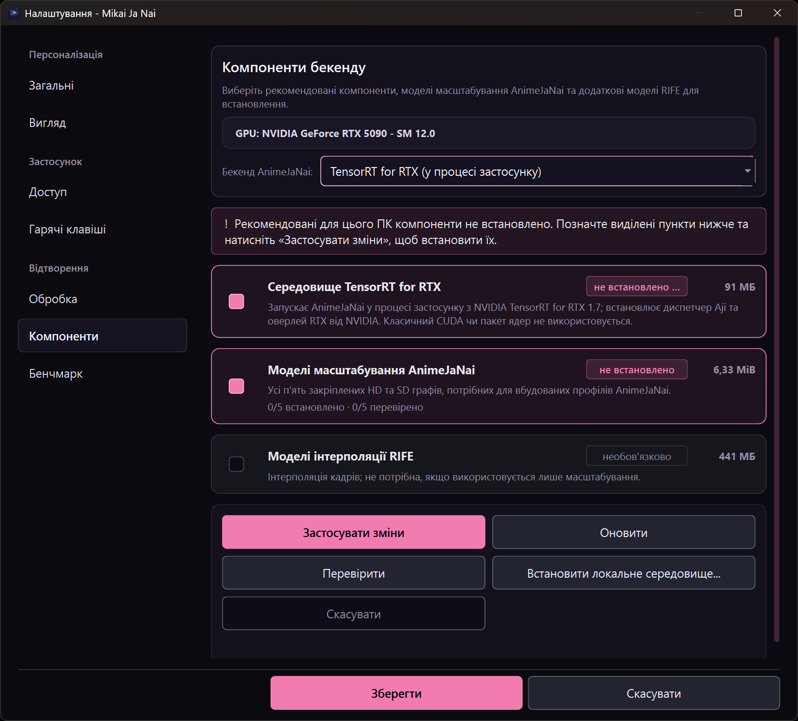

# Video processing guide

Mikai Ja Nai offers three different ways to process video: Anime4K shaders, Standard AnimeJaNai, and the separate Prepared Native workflow. Ordinary playback does not require any of them. Choose based on your platform, available components, and whether you want a shader preset, a Standard AnimeJaNai profile/model, or a prepared Native bundle.

For the comparison workstation and its controls, see [Compare and GIF export](player-guide.md#compare-two-processing-results). This guide covers processing setup and playback selection, not Compare usage.

## Optional video processing and components

| Workflow | What it is | Platform and prerequisites |
|---|---|---|
| **Anime4K** | GLSL shader presets using the OpenGL rendering path, from the 49 shaders staged at build time from one pinned upstream commit. No AI model download; the v4.1 GAN mode is included. | Windows and Linux; requires a usable OpenGL rendering path. |
| **Standard AnimeJaNai** | The regular AnimeJaNai manager, profiles and spatial models using the AnimeJaNai filter in the app's pinned mpv runtime. | Linux requires NVIDIA and TensorRT. Windows offers TensorRT, DirectML and the opt-in TensorRT for RTX; RTX is a separate download and is not included in the base package. |
| **Prepared Native** | A separate, private Native bundle/recipe workflow with distinct preparation, verification and bundle admission. It is not a Standard AnimeJaNai profile. | Windows-only in the app. The Native backend, recipe and required assets must be available for the current build and machine. |

The player organizes processing by effect: **Restore**, **Upscale** and **Interpolation**. **Restore** includes Anime4K presets; **Upscale** includes spatial Anime4K/AnimeJaNai models, built-in profiles and registered spatial graphs. Standard AnimeJaNai (AJI) is an execution/filter path, not an effect group. **Interpolation** is separate and contains RIFE choices; choose the effect/model first, then choose its available **Backend**. Compare renders original-frame/spatial candidates and excludes temporal/RIFE chains. The **video Benchmark** runs selected models and profiles on clips, including RIFE-only and mixed spatial-plus-RIFE profiles; it is not limited to still-image candidates. A selector, imported graph or installed component does not prove that a model will execute or that inference occurred. See [Native documentation](../native/README.md) for architecture, provenance and store details, and [AnimeJaNai runtime notes](animejanai.md) for Linux runtime failure modes.

The player presents these controls in its native Qt Quick scene. Its **Open enhancements** menu contains the effect/model choices and a **Backend** submenu; the **Q** Settings menu contains speed and scaling choices. **Settings → Processing**, **Components**, **Upscalers** and **Benchmark** remain in the application's Settings window; opening the player menus does not install or verify components.

## Where processing data is stored

The application resolves its native data root in this order:

1. `MIKAI_NATIVE_ROOT`, whenever it is set to a non-empty path (the app creates its own subdirectories under it);
2. `<applicationDir>/native`, when the application can create and remove a temporary write-probe directory beside the executable;
3. Qt's `AppLocalDataLocation/native` (typically `~/.local/share/Mikai/Mikai Wrapper/native` on Linux).

The root must be writable for acquiring and using components/models. A read-only AppImage mount or protected installation directory should use the user-data fallback; do not change permissions on a system directory to force storage beside the executable. Application startup removes only stale work files and staging trees, not installed components, models or configuration. See [the native component store documentation](../native/README.md#component-store-ownership-pack-membership-and-cleanup).

## Components: acquire and verify

The recommended setup omits optional RIFE interpolation models by default. Select them separately only when you need **Interpolation**; they are not required for **Restore** or spatial **Upscale**.

1. Open **Settings → Components**. Under the backend selector, a compact action bar provides a tri-state **Select all** checkbox, a live selection counter (*Selected: N*), **Verify**, and **Install selected**.
2. Select the items you need with the card checkboxes, or use **Select all** to toggle all available items. **TensorRT runtime** and GPU-matched **TensorRT kernels** may be recommended for the detected NVIDIA GPU when the classic TensorRT backend is selected; a compatible resource in the validated installed runtime or app-owned component store satisfies the GPU-kernel requirement. **AnimeJaNai upscaling models** comprises the five pinned HD and SD graphs used by the built-in Standard profiles. **RIFE interpolation models** are optional and serve the separate Interpolation effect, not spatial upscaling. **DirectML runtime** (Windows) is the non-NVIDIA choice and installs the ONNX Runtime DirectML 1.24.4 and DirectML 1.15.4 closure; it uses no TensorRT runtime, kernel pack or `trtexec`. If the saved backend is **TensorRT for RTX** (Windows), the runtime item is its own product instead: the standard dispatcher plus the ~95 MB NVIDIA TensorRT-RTX 1.7 overlay. Classic TensorRT kernel or CUDA packs are not used by RTX and are not queued for it.
3. Click **Install selected** and allow acquisition to finish. The button is dimmed to disabled while nothing is selected. These are optional AI components; ordinary playback works without them. Downloads are verified before installation. The UI displays progress/status for the selected work.
4. Click **Verify** to re-check installed components and model files against their recorded digests. Treat a missing or failed verification result as unavailable until repaired; “installed” and “verified” are distinct states.
5. Changing the backend dropdown persists the choice globally to `player/animejanai/backend` immediately, re-checks the store, and updates the inventory. Use **Cancel** in the action bar to cancel an active acquisition or verification; it is visible only while a run is in progress. Closing Settings does not cancel an active acquisition.

*The Components page with **TensorRT for RTX** selected and its runtime not installed. The capture was taken before any download: **Apply changes** was not used, nothing was installed and no inference was run.*

Runtime and model availability are platform- and GPU-dependent. Linux Standard AnimeJaNai uses TensorRT and requires its compatible runtime closure; there is no Linux TensorRT for RTX runtime. On Windows, TensorRT for RTX is opt-in: selecting it downloads nothing, and its runtime is installed only when you acquire it in Components. RTX builds its plan in-process with NVIDIA's TensorRT-RTX 1.7 runtime instead of the classic CUDA/TensorRT pack and `trtexec`. Read [AnimeJaNai on Linux](animejanai.md) before diagnosing a Linux inference-context or engine-build failure. Do not substitute an unrelated system mpv: the app uses its pinned runtime.

## Optional upscalers (downloaded ONNX graphs)

Four upscaler graphs are offered beside Anime4K and the AnimeJaNai profiles. They are not bundled: the build ships a pinned catalogue and the viewer downloads a graph on request.

| Graph | Factor | Precision | Download |
|---|---|---:|---:|
| Real-ESRGAN AnimeVideo v3 | 4× | fp32 | 2,492,908 B |
| Real-ESRGAN AnimeVideo v3 | 4× | fp16 | 1,253,495 B |
| HFA2kCompact | 2× | fp32 | 2,412,381 B |
| HFA2kCompact multijpg | 2× | fp32 | 2,412,381 B |

Download them on **Settings → Playback → Upscalers**, or select **Upscale models** on the Components page and use **Install selected**. Each download is proved against the catalogue's length and SHA-256 before it is stored, and the file lands in the app-owned custom-model directory, where it is registered like an imported graph.

Using one:

- **Player:** The **Upscale** choices list every graph with its stored state. An installed graph applies as a spatial AnimeJaNai step using its own factor (4× or 2×); a missing graph opens the page that downloads it.
- **Compare:** an installed graph is a comparison candidate like any other AnimeJaNai model.
- The first selection of a given graph at a given size builds a TensorRT engine and can take minutes; later selections reuse it. Switching away or closing while a build runs waits for the filter to detach instead of killing the process.

These graphs are spatial **Upscale** steps executed through the selected AnimeJaNai backend, like other spatial models. AJI/backend describes execution, not a separate effect category. The publisher's model card is the licence record for the bytes; this project does not redistribute them, and none of them is required for playback or for any Anime4K preset.

## Standard AnimeJaNai profiles and custom models

### Edit and save a profile

1. Open **Settings → Processing** and select **Standard**.
2. In the AnimeJaNai manager, select the profile/slot and chain you want to edit. Configure the available model steps, chain resolution/FPS bounds and any optional interpolation or resizing settings.
3. Commit the current chain's editor values before changing to another slot or chain; save the manager configuration when the edits are ready.
4. Use the manager's profile import/export controls when you need to move profile configuration. `.pconf` and `.conf` files contain configuration, not model graphs, runtime components or compiled TensorRT engines.

Manager/profile edits are deferred until **Save**. Custom model import, external registration and removal are immediate actions and are not undone by discarding unsaved profile edits. A failed config import leaves the current edits intact. The manager stores custom profiles in slots 1–10; profiles may contain ordered chains with resolution/FPS activation bounds. Chain selection is based on source geometry and FPS metadata, not the filename or transformed output size.

Sharp selects the corresponding HD model variant; it does not replace the SD branch. TensorRT shape/builder settings control preparation, not backend choice or graph compatibility. The built-in Static and Dynamic shape helpers use the ONNX input name `input`; graphs with a different input name may require compatible raw shape arguments or Static ONNX with an appropriate fixed shape.

In a chain, **Enable ONNX upscale steps** toggles ONNX upscale steps only; it does not disable Anime4K steps. ONNX steps expose **Temporal window frames** (0 means detect the window from ONNX; 1 means a single frame; the tooltip recommends an odd number up to 15) and **Temporal scene threshold** (0 disables scene-cut protection). Anime4K steps do not show those ONNX temporal controls. The separate **Temporal fix ONNX model** field takes a registered ONNX model identifier; leave it empty to disable that fix. Its **Temporal fix scene threshold** is adjustable, and **Temporal fix before upscaling** controls its placement. Do not confuse these controls with the separate per-chain RIFE interpolation settings.

**Enhanced scene detection (experimental)** is an independent per-chain RIFE option. It is off by default and catches some cuts missed by the standard threshold, at additional CPU cost. It is saved with the chain; it does not select another model or promise better interpolation on every scene.

The RIFE list includes **RIFE 4.26 Heavy**, but the official v0.27.0 runtime still maps model code `4262` to `rife_v4.26`, not to the heavy graph, and does not report heavy support. A chain selecting Heavy fails preparation explicitly instead of substituting another graph.

### Shared TensorRT storage

Standard TensorRT backends use the upstream shared per-user store, retained by a live reference to this application. Classic TensorRT requires NVIDIA compute capability **7.5 or newer**. DirectML and the private Prepared Native workflow keep separate local closures.

In **Settings → Components → Shared TensorRT storage**, use **Move to another drive…** or **Use default location**. Close other compatible AnimeJaNai applications first. On Windows, restart this app before moving a runtime used in the current session; loaded DLLs can prevent the move. The default path remains a managed junction/symlink, so backend mappings remain valid.

Moving changes only shared runtime storage, not ONNX models or compiled engine caches. Once copying starts, it cannot be cancelled safely; normal app shutdown waits for completion. Do not disconnect either drive or force-terminate the process. No crash-recovery guarantee is claimed.

### Import an ONNX model

1. Open **Settings → Processing → Standard** and choose **Import .onnx Model…**.
2. Select the self-contained spatial ONNX graph. The manager describes compatible imports as 4-D `1x3xHxW` RGB graphs from RealESRGAN, Compact (SRVGGNet), SPAN, DAT or SwinIR; the import check itself establishes ModelProto framing only, so that list is guidance rather than a compatibility proof. The app imports the graph into its owned model directory, records integrity/provenance metadata and, when registration completes, makes it available in the model catalog, player spatial-model menu, profiles, Compare and Benchmark.
3. Confirm the model is shown as registered before using it. Use the manager's **Remove Selected** only when you intend to remove an app-owned imported model or its registration.

Downloaded upscalers are ordinary registered graphs in the same store, so they appear in the model catalog, player menu and Compare alongside a manually imported graph.

An external-model directory is an optional candidate-browsing location. Registering an external graph records a reference and digest; the file is borrowed, not copied, modified or deleted. Removing an external registration leaves the graph in place. A graph pasted directly into the owned directory is only an unregistered candidate; select it and use **Import .onnx Model…** to register it before use.

Validation establishes a plausible ONNX graph/provenance record, not tensor, operator, shape, dtype, backend or GPU compatibility. Filename-derived scale/architecture labels are hints. Multi-file external-weight packages are not imported as bundles. Importing/registering a graph does not grant redistribution rights; users remain responsible for applicable model and weight licenses. See [Standard AnimeJaNai model and profile details](../native/README.md#2-standard-animejanai-custom-models--profiles).

## Prepared Native workflow

Prepared Native is not the Standard AnimeJaNai manager, its model staging, or its `.pconf` profiles. On Windows, select **Native** under **Settings → Processing** to reveal its backend, recipe, availability status, Native assets/preparation panel and RIFE controls. Linux does not offer this private Native runtime in the app. This track keeps the historical AJI ABI-8 contract and runs only TensorRT or DirectML; it is distinct from the ABI-9 Standard filter/runtime and has no TensorRT for RTX option. A saved RTX request is kept but cannot run here.

Before starting, confirm that the desired backend/recipe and required Native assets are available. The assets panel is wired to a live-video source-presence check; it reports that preparation cannot proceed when no source-presence path is available. Use the Native assets/preparation UI for the available recipe and source, then wait for its status/progress to settle. The panel's **Cancel** controls apply separately to model import and preparation; cancellation is cooperative, and preparation already publishing its result can no longer be cancelled. Do not treat a generated raw TensorRT plan, an imported ONNX model, an AJI engine build, or a “prepared” label from a different tool as equivalent to verified Native bundle admission.

The Native helper tools have separate roles: `native_inspect` can inspect ONNX and run CPU reference inference; `mikai_native_prep` builds a raw TensorRT plan out of process; `mikai_native_verify` checks plan bindings and numerics; bundle tooling verifies the versioned bundle manifest. `mikai_native_prep` success only means it wrote a non-empty raw plan. Read [Native documentation](../native/README.md) and the [MSVC + CUDA/TensorRT helper notes](../native/build-msvc.md) for the precise contracts and prerequisites. Those tools and checks do not establish unobserved GPU playback or performance.

## Select processing during playback

Processing is optional; playback starts with the **Original** pipeline unless a processing choice is explicitly selected. In the player, open the processing controls and choose an available **Restore**, **Upscale** or **Interpolation** effect/model. Anime4K and Standard AnimeJaNai spatial choices provide restoration/upscaling options; RIFE models are interpolation choices. For Standard, built-in profiles and registered spatial models are distinct choices; a profile can choose chains according to source resolution/FPS. AJI identifies the execution path; choose the available backend separately. For Native, the selected runtime, backend and recipe must be available for the running app; changing runtime may require restarting the app as indicated by Settings.

The backend is chosen separately from the effect/model. In the player's execution/backend controls, choose TensorRT, TensorRT for RTX or DirectML; the same saved choice is applied by the next processing request. All three rows are listed on both platforms, but only Windows provisions the latter two: RTX builds engines in-process and needs its own installed runtime, while a Linux DirectML request fails with “DirectML is only available on Windows; select TensorRT on Linux.” Linux RTX is shown as unavailable by name because no Linux runtime is published. Neither request is silently substituted with another backend. Changing the backend dropdown in **Settings → Components** immediately stores the selection as the global backend (`player/animejanai/backend`), which the player and the Benchmark tab directly follow.

If an option is absent, inspect **Settings → Processing** availability and **Settings → Components** verification before assuming it can be selected. An installed ONNX graph or profile registration does not establish that its backend can execute it. A failed runtime/model setup is an error, not evidence that the GPU is too slow. Ordinary playback remains available without processing components.

## Benchmarking

### Prepare a run

1. The application packages its own synthetic benchmark clips at `480x360.mp4`, `640x480.mp4`, `768x576.mp4`, `1280x720.mp4` and `1920x1080.mp4`. Windows portable and setup packages place them in `benchmarks/` beside the executable; Linux packages place them under `share/mikai/benchmarks/` within the installation prefix. A development checkout uses `resources/benchmarks/`.
2. Open **Settings → Benchmark**. Select the clips, the unfiltered baseline if desired, and the model groups/individual models to measure. The catalogue may include registered custom graphs and profiles as well as built-in entries.
3. Before a Native/AnimeJaNai model run, acquire and **Verify** the required components/models in **Settings → Components**. The benchmark uses the saved Standard backend and names it in the toolbar (**Engine: <backend>**); a TensorRT for RTX run remains identified as `tensorrt-rtx`, and a failed requested backend is not counted as another backend. Selecting a profile includes its configured chains, including RIFE interpolation and mixed spatial-plus-RIFE processing; a separate RIFE model-group selection is not required for RIFE configured in that profile.
4. Click **Run benchmark**. Preparation/engine compilation is separate from the clip-processing sample. The video benchmark exercises the selected video clip and model/profile configuration; its result is specific to that run and is not a promise of playback performance on other footage or systems.

### Interpret the output

Benchmark entries describe a particular clip and selected model/profile configuration. Keep failed or unavailable rows distinct from completed entries; do not treat a failure as a measured result. Packaged clips are project-generated synthetic black-frame H.264, not anime footage. Historical captures in [`bench_results.md`](../bench_results.md) used separate black-frame clips and are not comparable to the packaged files or a guarantee about anime-scene behavior. Results vary with GPU, driver, backend, clip, output size, model/profile settings and engine/cache state; unlike runs are not controlled comparisons.

Preserve the generated JSON with the GPU/driver, CPU, OS, application revision, backend, input/output dimensions, selected model/profile configuration, each custom model's full file location and 12-character SHA-256 prefix, and whether engines were already cached or built. The report destination differs by platform: Windows writes under `bench/` beside the executable; Linux uses Qt's writable `AppLocalDataLocation/bench`.

## Troubleshooting checklist

- **Processing choice missing:** refresh Components, verify installed items, confirm model/profile registration and check the selected runtime/backend availability. Do not infer compatibility from an ONNX import succeeding.
- **Acquisition cancelled or interrupted:** refresh inventory, run **Verify**, and apply/reacquire the missing or failed selected packages as indicated. Closing Settings alone is not cancellation.
- **TensorRT for RTX unavailable or failing:** confirm Windows and that its runtime was acquired from Components (the standard dispatcher plus the TensorRT-RTX 1.7 overlay); the base package does not include it. On Linux the backend is reported unavailable by name because no RTX runtime exists there. A missing or mismatched runtime is a setup error, not a GPU-speed result; when the dispatcher falls back to classic TensorRT, Compare and Benchmark report that run as a failure.
- **Heavy RIFE model refused:** the official runtime does not report heavy RIFE support; select a non-heavy RIFE model instead of expecting a silent graph substitution.
- **Linux Standard AnimeJaNai failure:** consult [Linux fork integration and failure modes](animejanai.md), especially its loader-path and shell-safe engine-build path requirements. The engine build log is authoritative for the documented path-splitting failure.
- **Benchmark row failed:** read its failure detail and distinguish setup/runtime/model refusal from a completed row. Check the relevant packages and backend, and ensure clips have the expected exact names and dimensions.
- **Benchmark profile behavior is unexpected:** a selected profile runs its configured chains, including any enabled RIFE interpolation; a separate RIFE selection does not override that profile configuration. Packaged black-frame synthetic clips do not predict anime playback.

## Further reading

- [Native Enhancement Provenance, Manifests & Component Store](../native/README.md)
- [AnimeJaNai on Linux: fork integration and failure modes](animejanai.md)
- [MSVC + CUDA + TensorRT build notes](../native/build-msvc.md)
- [Historical benchmark captures and limitations](../bench_results.md)
