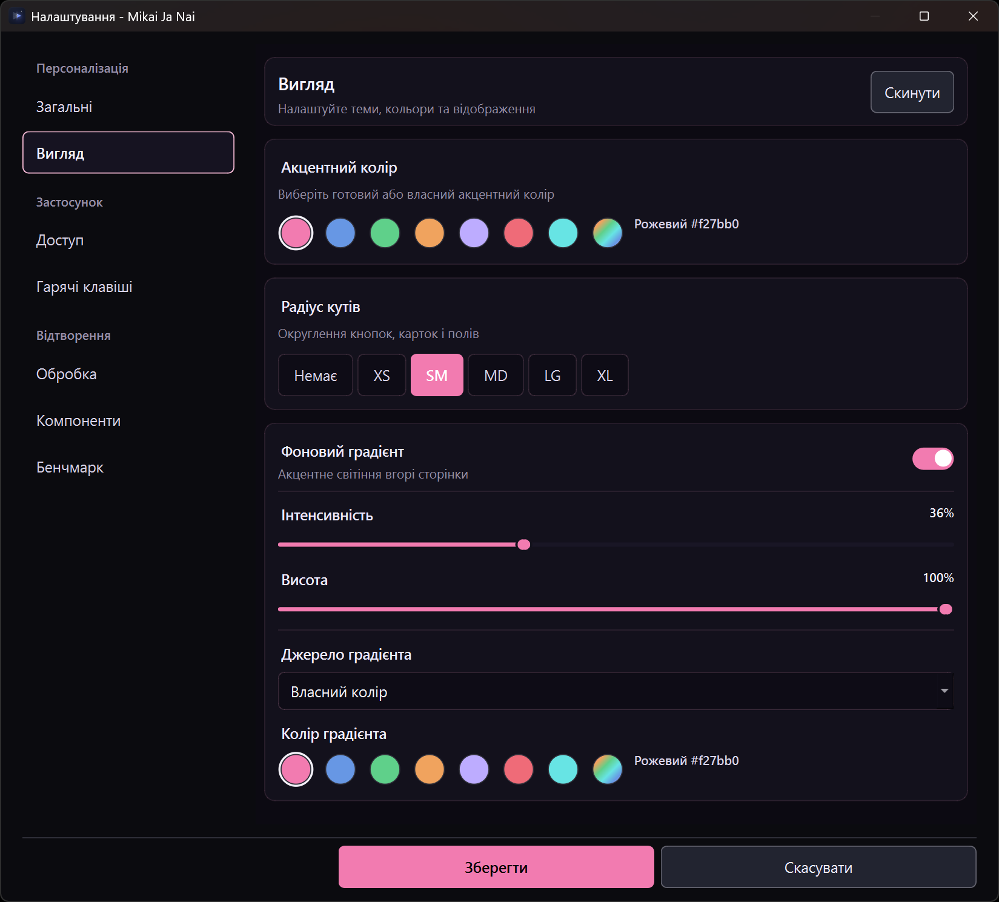
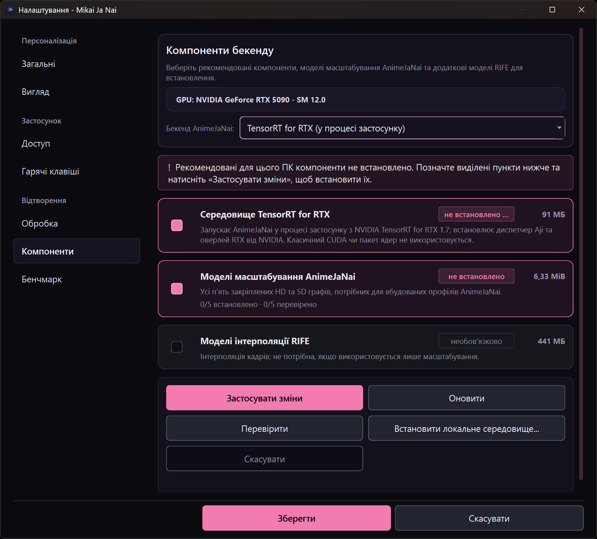

# Settings guide

Open **Settings** from the main window. The settings window has these pages:

| Group | Page | Use it for |
|---|---|---|
| **Customization** | **General** | Site theme, content/name language, cover display, 18+ display, and system integrations |
| **Customization** | **Appearance** | Accent, corner radius and background gradient |
| **Application** | **Access** | Mikai and OpenSubtitles API keys, home-page feed sections, interface language, HDR playback and video scaling |
| **Application** | **Keyboard shortcuts** | Anime4K preset key bindings |
| **Playback** | **Processing** | Runtime module selection and the Standard and Native processing workflows |
| **Playback** | **Components** | Downloadable backend components, models and their install state |
| **Playback** | **Benchmark** | Video-clip processing comparison |

The sidebar groups the pages as listed, and the window normally opens on **Customization → General**; an invalid stored preset binding opens **Application → Keyboard shortcuts** instead so the conflict is visible. Page contents scroll independently; the **Save** and **Cancel** buttons stay in the Settings footer. **Save** commits preferences immediately and remains open (displaying an inline **Saved** confirmation for a moment), allowing continuous adjustments across multiple pages without closing the window; **Cancel**, Escape, or closing the window closes it. For detailed processing, component installation and benchmark instructions, see the [processing guide](processing-guide.md).

## Change appearance and display preferences

In **Customization → General**:

- **Site theme** switches between dark and light.
- **Content titles language** selects Ukrainian, English or original titles.
- **Names language** selects **As the interface**, Ukrainian, English or original names.
- **Gradient overlay** controls the gradient drawn over cover images, including home cards, title-page covers and related-title artwork.
- **18+ content** allows explicit content without a warning and is **on by default**. Turn it off to be asked before the first playback of a title rated 18+.

In **Customization → Appearance**:

- Choose an accent-color swatch or use the custom color picker.
- Choose a corner radius. This affects the app's rounded controls, including title-page buttons, and player chrome as well as the rest of the interface.
- Toggle **Background gradient** to show or hide the accent glow at the top of the page. When it is off, its intensity, height, source and color controls are disabled. When on, adjust intensity and height with the sliders.
- **Gradient source** decides where the glow's colour comes from. **Auto (follow accent)** paints the glow with the chosen accent, so the page wash can never disagree with the buttons. **Custom color** reveals the preset swatches and the custom picker and paints the stored colour. Switching back to Auto does not overwrite the stored custom colour: it is kept until you save a different Custom choice, so you can return to it.
- A profile created by an older version, which stored a gradient colour separately and had no source setting, keeps that colour as a **Custom** choice. The app cannot tell a deliberately chosen colour from the old default, so it never discards one; pick **Auto (follow accent)** once to join the accent.
- **Reset** resets the appearance-page choices (accent, radius and background-gradient settings, including the gradient source) to the shipped values. It does not reset the separate General-page choices.

*The Appearance page with a custom pink accent and custom gradient — an example choice, not the shipped defaults. The capture was taken with no edit saved.*

Appearance and site/content display changes preview while Settings is open. **Save** keeps them; **Cancel**, Escape, or closing the dialog restores the appearance from when that Settings session opened.

### Action colours

Every action in the interface is one of four roles, and the accent you pick fills the first of them:

- **Primary** - the accent itself, with a black or white label chosen by contrast so a very dark or very light custom accent still reads. Used for the one obvious action on a surface: Search, Watch, Save, Install selected (when packages are chosen), and progress chunks.
- **Secondary** - a raised neutral fill with a visible boundary; it is what an unlabelled button is. Filters, Teams, Cancel, and the player's chrome chips use it. Hovering moves it toward the accent.
- **Ghost** - no fill, accent text, for inline and keyboard-hint actions.
- **Danger** - a danger-coloured outline, for destructive removal only.

Neutral controls are deliberately lighter than they used to be: their boundary is the part that carries them, so a dark button is visible on a dark page.

Changing the accent and saving restyles everything that is already open - the search page, the Compare window, a running engine-preparation window, the player's chip strip, the picture-in-picture bar and the media information window - without a restart.

## Interface language, token and feeds

In **Application → Access**:

### Interface language

Choose **Use system language**, **English** or **Ukrainian**. A new choice is applied immediately to open application windows, including an open player; it is only a saved preference after **Save**. Cancel or closing Settings restores the language that was active at opening. If the requested translation catalog cannot be applied, the language remains unchanged and the selector returns to the installed language with an error message.

The interface language is independent of the title and name language choices under **Customization → General**.

### Mikai API access token

The page is also reachable from the header: the **RPM** pill on the main page and the quota line on a title page open Settings directly on **Access**, because the chip reports the key's quota. The **Test** button beside the token field checks a key without saving it.

The token is optional. The advertised public API limits are **299 requests per minute without a key** and **599 with a key**. The client uses these estimates until response headers supply the current quota; server-provided limits take precedence.

Use **Test** to check the text currently in the field; testing does not itself save it. Get a key from the linked Mikai developer dashboard. Keep the token private: it is sent to the Mikai API, and any `.env` file containing it should not be committed or shared. The app writes the key as `X-API-Key: …`; on Windows it restricts the file to the current user, and on Linux it grants read/write access only to the file owner.

Leaving the field blank saves anonymous access, as the field's placeholder says. Saving a changed blank key writes an empty `.env` file in place instead of deleting it.

The client first checks `.env` beside the executable, then in its immediate parent directory; the first existing file wins, and it does not search farther up. The current working directory is deliberately not searched. When a save changes the key, it writes the first location that already existed, or `.env` beside the executable when none did; an unchanged key is not rewritten. At client initialization, a non-empty `MIKAI_API_KEY` environment variable takes precedence over the file. If saving the key fails, the app reports the error and leaves the active key unchanged.

The **API usage** readout shows the current limit and, after API responses arrive, usage/remaining requests, active and queued work, and reset countdown where available. It may initially say it is waiting for the next response.

### OpenSubtitles

Create an API key on the linked [OpenSubtitles API consumers page](https://www.opensubtitles.com/en/consumers), enter it under **Access** and select **Save**. The player uses the same key for its OpenSubtitles search; the key is stored in the app-data folder — protected with Windows DPAPI on Windows, in a file only your user account can read elsewhere — and can also be entered in the search dialog.

### Home page sections

Check the home-page sections you want loaded. Disabled sections are not loaded and do not use API requests. Search and title pages remain available regardless. Feed choices are saved on **Save**.

## HDR playback

The **HDR playback** controls are on **Application → Access**:

- **Auto (recommended)** selects the automatic tone-mapping policy.
- **Stable - no per-frame adaptation** disables per-frame adaptation.
- **Vivid - Mobius curve** uses a Mobius curve.
- **Native enhancement for HDR** allows Native enhancement stages on HDR video. Those stages require 8-bit NV12; enabling this option does not convert the source to SDR and may reduce HDR image quality.

These settings are separate: HDR tone mapping describes how HDR video is mapped to a display, while Native enhancement is a processing choice. Saved HDR changes reach a running player shortly after saving.

## Video scaling

**Video scaling** is the card immediately after **HDR playback**, on the same page. It controls how the picture is mapped into the window and which mpv scalers resample it. It does not change AnimeJaNai's own resolution.

- **Native (fit to window)** is the default and preserves the video's display aspect ratio, including in fullscreen. Existing scaling-mode preferences are reset once to Native; a later explicit choice is saved. **Fill (crop edges)** crops to fill the picture area. **Stretch** distorts to fill it and ignores the stored zoom while it is selected. **16:9** and **4:3** force that aspect. **Original size (1:1)** shows physical pixels, centered and cropped when they do not fit.
- **Zoom** runs from −50% to +100%. It is a viewing preference and is not reset when the source changes. Stretch and original size keep the stored percentage but do not apply it.
- **Upscaler** and **Downscaler** choose the display resample. Downscaler **Auto (recommended)** restores the running core's own default after the player has initialized; it does not send the literal `auto`, which this runtime rejects. If that default cannot be read, the player says so and the previous downscaler stays until you choose one or reopen the player.
- The player settings flyout has the same mode list, without the zoom and scaler rows. Compare always uses Fit while a comparison owns the picture, so the panes stay comparable. Picture-in-picture follows the saved setting.

Saved changes reach a running player on the next event pump. A paused picture redraws after the asynchronous option writes complete without resuming playback. Changing mode rewrites keep-aspect, panscan, aspect override, unscaled, zoom, scale and downscale together, so an old crop or override cannot survive the switch.

## Anime4K preset keyboard shortcuts

Open **Application → Keyboard shortcuts**. Focus a shortcut field and press a key or a combination using Ctrl, Alt or Shift. Use the field's clear button to remove one binding. **Clear all** clears all preset bindings in the page; the filter matches preset names and key text and does not change bindings.

A key combination can belong to only one preset, and built-in player shortcuts are reserved. A conflicting edit is rejected and the page explains the conflict; saving is also blocked while the preset bindings are invalid. Bindings are written on **Save**, not as soon as you type them.

## Processing runtime, components and benchmark

**Playback → Processing** is headed **Processing runtime**. Its **Runtime module** choice is **Standard**, or **Native** on Windows. Saving stores the choice; when it differs from the runtime the running process loaded, the page says the runtime will change after restarting Mikai Ja Nai, and the dialog does not replace the running core itself.

- **Standard** shows the AnimeJaNai manager card, which owns the official models and profiles, including TensorRT for RTX on Windows. In the player, **Restore**, **Upscale** and **Interpolation** are effect categories; Standard AnimeJaNai (AJI) is an execution path, not an effect category. Choose its backend separately from the effect/model.
- **Native** (Windows only) replaces that card with **Backend**, **Recipe**, the Native model-assets card and **RIFE interpolation** controls. RIFE is for the separate Interpolation effect, not a spatial upscale choice. Only Native fields you actually changed are written, so an untouched preference block survives an unrelated save. Preparation and model work started from these controls is an operation, not a pending preference.

Platform boundaries are stated in the pages themselves:

- On Linux the runtime selector offers only **Standard**, and the page header says that DirectML, TensorRT for RTX and the private Native runtime are Windows-only.
- **Playback → Components** is headed **Backend components**. On Windows the backend selector offers TensorRT, DirectML and **TensorRT for RTX**; on Linux it offers TensorRT only. Choosing an engine in this selector immediately persists the choice as the global backend (`player/animejanai/backend`), which the player and the Benchmark tab directly follow. A stored RTX choice opened on Linux appears as **TensorRT for RTX (unavailable on this platform)**, and the page explains that the runtime is available only on Windows.
- Under the backend selector, a compact action bar provides a tri-state **Select all** checkbox and a live selection counter (*Selected: N*) on one row, and **Verify** (ghost action) plus **Install selected** (accent primary action, dimmed to disabled when 0 items are checked) on the next. The two rows keep the bar inside the minimum dialog width in both languages. **Cancel** appears in the action bar only while a download or verification run is in flight. Opening these pages does not prepare a model or start inference. **Install selected** downloads the selected missing components, and **Verify** re-checks installed elements against their digests. The downloaded files are the app's own components, not GPU drivers.

**Backend components** also carries two inventory-only rows that never download by themselves. **Anime4K shaders** states how many preset chains the shipped shader tree can serve (`installed` only when every catalogue preset has all of its files). **Upscale models** states how many of the optional ONNX graphs are stored — `optional`, `partial` or `installed` — and selecting it queues the missing graphs with **Install selected**; the Upscalers page manages them one at a time.

While an acquisition runs, the window-level bar names the bytes received (`Downloading 2 items: 480 MB of 1.2 GB`) and carries a progress line; when a transfer cannot state a total, the line is indeterminate rather than a stalled percentage. The same line is mirrored into the player's status panel, because that window covers the bar while a video is open. Closing Settings does not stop the run.

### Upscalers page

**Playback → Upscalers** lists every optional upscaler the build offers: 4× Real-ESRGAN AnimeVideo v3 in fp32 and fp16, and 2× HFA2kCompact plus its multijpg variant. Each row shows the graph's own scale, precision, publisher and download size, and carries exactly one action: **Download** while it is absent, **Remove** once it is stored. A download verifies the pinned length and SHA-256 before a byte reaches the model folder, refuses to overwrite a same-named graph with different bytes, and reports its own failure text instead of a bare state. Nothing downloads unless a row is pressed, and no Anime4K preset depends on any of them.

The graphs land in the app-owned custom-model directory (`…/animejanai/models/custom/`) and are then selectable as spatial **Upscale** steps executed through AnimeJaNai in the player and as spatial comparison candidates. The publisher's model card is the licence record for those bytes; this project does not redistribute them. See [Optional upscalers](processing-guide.md#optional-upscalers-downloaded-onnx-graphs).

*The Components page during the Windows capture: TensorRT for RTX selected, its runtime reported as not installed, and no download started. The capture does not show a working RTX runtime or any inference result.*

**Playback → Benchmark** is headed **Benchmark**. The bottom toolbar displays the active engine (**Engine: <backend>**, e.g. *TensorRT for RTX*), following the global choice selected in Components and settings. Choose **Video clips** and **Enhancement models**, optionally keep **Include the unfiltered baseline**, then press **Run benchmark**. Its video runs support RIFE interpolation, including RIFE configured in mixed spatial-plus-interpolation profiles; Compare is a separate still-frame workflow and does not run temporal chains. A run uses the current selection and is not a saved preference. For clip locations, reports and limitations, see the [processing guide](processing-guide.md).

## Windows and Linux system integrations

Find these controls under **Customization → General → System integration**. They apply to the current user account and take effect on **Save**. They do not take effect just by checking a box.

| Control | Windows | Linux |
|---|---|---|
| **Start Mikai Ja Nai when I sign in** | Registers the app for the current Windows user. | Registers the app for the current user using XDG autostart. |
| **Open With** | Label: **Add Mikai Ja Nai to the video file context menu**. Adds an **Open with Mikai Ja Nai** video-file context-menu command without changing the default app. | Label: **Add Mikai Ja Nai to video files' Open With list**. Registers the app as a video-file **Open With** candidate; file managers decide where it appears. |

Neither platform option forces file associations. On Linux, the desktop decides how default-app settings and Open With entries are presented. If default-player registration was requested, disabling Open With keeps the desktop identity so existing defaults can continue to refer to it; a package-managed entry cannot be disabled in the app. On Windows, an existing unmarked context-menu registration or one owned by another installation is left unchanged rather than adopted.

Before moving a portable application folder, disable its startup and Open With integrations, move it, then enable them again from the new location so registered paths can be updated. If the move happened first, a stale Windows startup entry may need to be removed from Windows before enabling startup at the new location. If saving an integration fails, Settings stays open with the edits. The integration writer attempts rollback; the app reports if rollback itself could not restore the previous state. On platforms other than Windows and Linux these controls are unavailable.

The player also has a **Set as default video player…** action in its **Quality and speed** flyout. It registers Mikai Ja Nai as a per-user candidate and opens the Windows or desktop Default Apps settings; it does not change defaults automatically, so choose Mikai Ja Nai and the video file types there. Registration refuses conflicting entries it does not own, and if a registration write fails it attempts to restore the prior values. Candidate registration can succeed even if opening the OS settings fails. In that case, the error gives the manual route; the registration remains and can be used when choosing a default later.

## Save, Cancel and work that starts immediately

Treat **Save** as applying several settings stores, not as one all-or-nothing transaction. Most ordinary preference edits are committed on Save; language and appearance are previews that can be rolled back until their commit succeeds. Save validates shortcut bindings before writing. It then makes the fallible writes in this order: the API token (only when it differs from the active key), the AnimeJaNai configuration when that manager is dirty, the changed Native backend and recipe fields, the runtime choice, the interface-language catalog, and the system integrations. The appearance, language preference, feeds, HDR tone-mapping policy and Native-on-HDR override, video scaling and preset bindings are committed after those writes succeed.

If the requested interface-language catalog cannot be applied, Save stops before the system integrations and the remaining commits; the earlier writes stay saved.

If a later save step fails, earlier independent writes that already succeeded remain saved. For example, if an integration fails after the token was written, cancelling afterward does not undo the token write. The dialog explains that other settings may already be saved; Cancel restores unsaved language and appearance previews, not previously completed writes. A failed write also brings its own page forward - **Access** for the token or language, **Processing** for the AnimeJaNai, Native or runtime stores, **General** for system integrations - and keeps Settings open. System-integration changes have their own rollback attempt, but an OS error can prevent complete rollback.

Some page actions are operations, not pending preferences:

- **Test** makes an API request using the token currently in the field.
- **Components** downloads, verification and local-runtime installation run from that page's own controls. Its **Cancel** stops the active component operation; closing Settings does not act as that button.
- **Benchmark → Run benchmark** starts a measurement using the current selections; it is not saved by the Settings footer.

## Settings identity, files and logs

The application keeps the existing Qt settings identity: organization **Mikai**, application **Mikai Wrapper**. Updates preserve preferences stored under that identity; do not delete or rename the settings store to troubleshoot an unrelated issue.

The API token is stored in `.env` as described above. The app session log is `mikai.log`: it is written beside the executable when that directory is writable, otherwise under Qt's application-local-data directory (including read-only AppImage cases). At startup, an existing log at or above 2 MiB is rotated to `mikai.log.1` before the new session is appended. Crash reports are written beside the log. There is no in-app log-location setting.

Logs and benchmark reports can contain diagnostic details and environment or file-path information. Review them before sharing. Do not share `.env` or expose its token. For where benchmark reports and supplied clips live, see the [processing guide](processing-guide.md#benchmarking).
