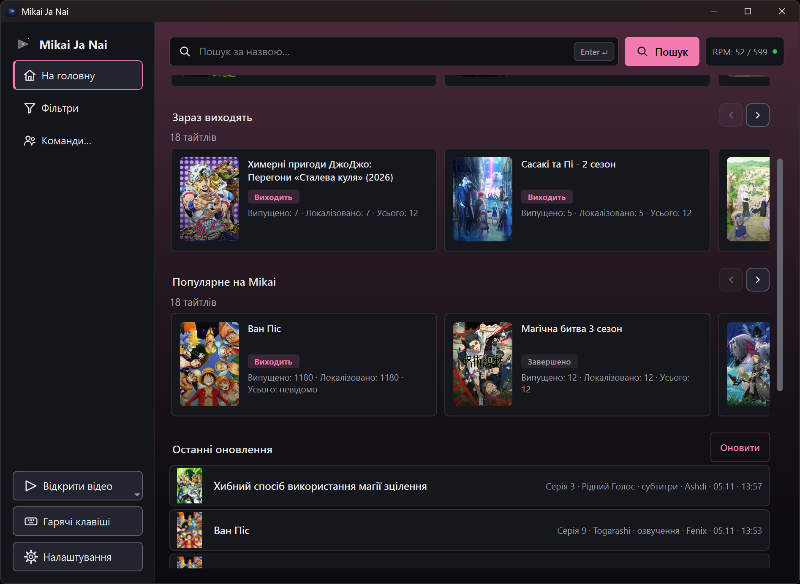
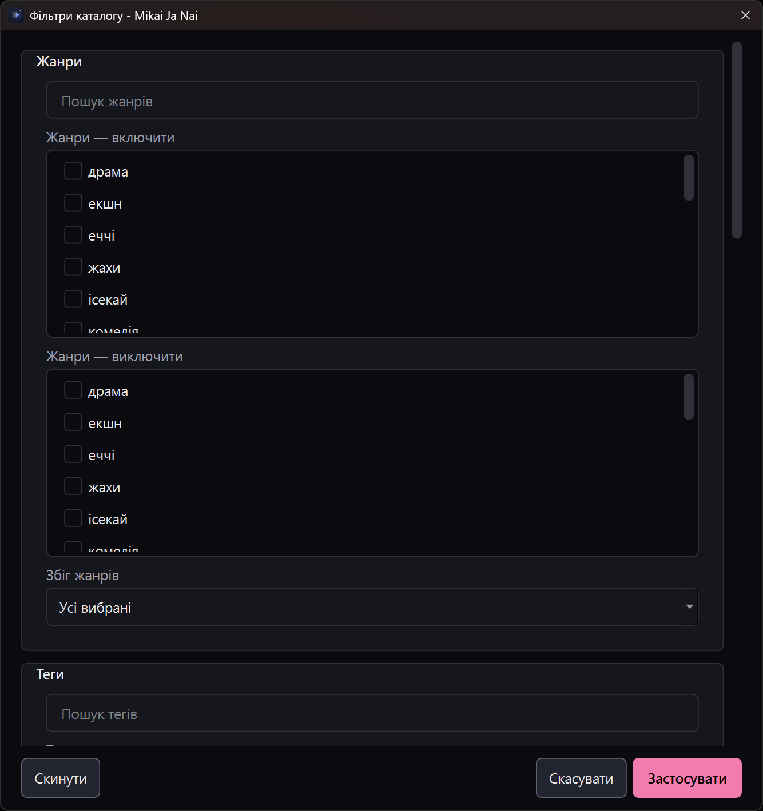

# User guide

Mikai Ja Nai is an unofficial desktop client for the read-only Mikai Public API, with a separate local video player. You can browse the catalogue without downloading processing components, and you can play local files without catalogue access. Mikai is the service and API; **Mikai Ja Nai** is this application.

This guide gets you from opening the app to finding a title and choosing an episode. For focused instructions, see the [playback and Compare guide](player-guide.md), [processing and components guide](processing-guide.md), and [settings and privacy guide](settings-guide.md).

## Install and first launch

Use the [official GitHub releases page](https://github.com/smyhlin/Mikai-Ja-Nai/releases) for published artifacts; do not use unofficial mirrors. On Windows, either run the per-user setup installer or extract the portable ZIP and launch the app from its extracted folder. On Linux, choose the AppImage, dependency-based `tar.gz`, Arch `pkg.tar.zst`, or Debian `.deb` that matches your distribution and workflow. The Arch and Debian packages are installed with their distribution's package manager; the AppImage is run as an AppImage, and the tarball is unpacked and run. See the [Linux packaging notes](releasing.md#linux-x86_64), [distribution package details](releasing.md#distribution-packages-arch-debian), and [build-from-source guide](building.md) for platform prerequisites and packaging details.

Windows setup offers **Update** when it finds an existing installation registered for the current user. If both report the same version, setup can update or repair it but cannot tell which build is newer. Portable copies are not registered automatically; choose the intended folder explicitly if updating one.

Published artifacts are unsigned and each release provides `SHA256SUMS`. Release QA and third-party source/license obligations remain open; see [release status](release-status.md) and [redistribution notes](redistribution.md). When launched directly, the app may offer optional component setup; file launches do not show this offer. You can decline it and use ordinary playback.

The original Windows v0.1.0 packages can fail on startup with `__cxa_call_terminate` missing from `Qt6Core.dll`. The [player and usability update](https://github.com/smyhlin/Mikai-Ja-Nai/releases/tag/v0.1.0-update-20261101) includes the fix.

## Start here

Launch the installed or portable application. The left sidebar provides **Home**, **Filters** and **Teams…**, with **Open video**, **Shortcuts** and **Settings** rows at the bottom. In narrower windows the sidebar becomes an icon rail: the brand name is hidden and tooltips name each action. **Home** returns to discovery, **Filters** opens the catalogue-filter dialog, and **Teams…** opens the team picker.

**Open video** is a menu with **Video file…** and **Video URL…**. A chosen file or stream address opens in the player without using the catalogue, and it keeps working when catalogue requests fail; see [local video or URL playback](player-guide.md#local-video-or-url).

The search field (**Search by title…**, with its **Enter** key hint and return arrow), **Search** and the **RPM** quota pill stay in the top toolbar while the Home blocks scroll below. Press **Enter** in the field to search. **Shortcuts** opens the keyboard-shortcut overlay; **Escape** closes it and returns to Home.

The **Latest updates** and **Release schedule** rows keep their full caption and scroll sideways when a window is too narrow: **Shift + wheel** moves half a viewport, **Alt + wheel** scrolls smoothly, and a plain wheel still scrolls the page.

Home stacks **Recently opened** (titles opened on this machine), the **Currently airing** and **Popular on Mikai** carousels, then the **Latest updates** and **Release schedule** lists. Carousel arrows page by the visible cards, and **Alt + mouse wheel** over a carousel scrolls it horizontally; a plain wheel still scrolls the page. The four server-backed blocks can be switched off under **Settings → Access → Home page sections**, and a disabled block is not requested; **Recently opened** stays because it is local. Open a result to see its title page, releases and episodes. On a title page the genre and tag chips are links: a click opens the catalogue filtered by that genre or tag, replacing the current filters. Settings groups **Customization** (General, Appearance), **Application** (Access, Keyboard shortcuts) and **Playback** (Processing, Components, Upscalers, Benchmark); its footer holds **Save** and **Cancel**.

Catalogue browsing works anonymously, subject to the service's anonymous limits. A key is optional: enter it under **Settings → Access**, choose **Test**, then **Save** to use the higher keyed limit. Keep the key private; it is sent to the Mikai API. The Access page also carries the **API usage** readout. The [API reference](https://api.mikai.me/public/docs) explains the public API contract.

The Home/Search header’s **RPM** pill reads **RPM: used / limit** from the last response that carried quota headers; its tooltip adds the remaining requests, the reset countdown and any queued requests. Its dot is neutral until quota data arrives, and the other tones mark healthy, low or exhausted remaining quota rather than a general connection-health check. The title page shows the same usage inline in its header. Both are shortcuts: pressing the pill (or the title page's inline line) opens **Settings → Access**, the page that owns the key the quota belongs to.

*Catalogue home. This capture is a Windows build with the Ukrainian interface and a custom pink accent, so your own accent, language and window size will differ; catalogue content and availability change upstream.*

## Find titles and filter the catalogue

1. Enter a title or search phrase in the top search field, then press **Enter** or choose **Search**. The status line reports **Found: N** or **Nothing found**, and the pager below the list moves through later pages. An empty search returns to Home when no catalogue filters are selected; when filters are selected it runs the filtered catalogue instead. Selected filters survive either case.
2. Open **Filters** (the dialog is titled **Catalogue filters**) to narrow results. Its **Genres** and **Tags** sections have include and exclude lists; **Release** holds year-from/year-to ranges, a comma-separated list of exact years, and format, status, season and studio selections; **Sorting** sets the sort field and order. The search fields narrow the displayed genre, tag and release-option lists.
3. For selected genres or tags, choose **Match all** or **Match any**. Include and exclude selections let you shape a result set—for example, include a genre and exclude a tag you do not want.
4. Choose **Apply** to apply the selections, or **Reset** to clear catalogue criteria and apply that cleared state. Both actions keep the search text. **Cancel** discards edits made in the dialog.

*The **Catalogue filters** dialog. Selections are applied only when you choose **Apply**; **Cancel** discards them.*

Examples: to look for recent television releases, set a year range and choose the relevant format. Use the sort controls to order by name, year, recently updated, views or MAL rating, ascending or descending; text searches use relevance ranking, so the selected sort may be retained but overridden. When results mix formats, tabs with counts appear above the list (**All (36)**, **TV (24)**); choosing one filters the whole result set, and **All** removes that filter. Right-click a Home card for **Open**, **Copy link**, **Copy ID** and **Open in browser**; right-click a results row for **Open**, **Copy link** and **Copy ID**. Results reflect catalogue data and selected criteria; an empty result does not establish that a title is unavailable from every source.

If filter choices are missing because the catalogue dictionaries did not load, **Filters** offers **Retry dictionaries**. A failed catalogue request is not a playback failure: local-file playback remains separate from the API.

## Browse translation teams

Open **Teams…** to get the **Select a team** dialog. Type in **Search teams**; the status line reports the team count and page (for example **120 teams · page 1 of 3**), and **Load more** fetches the next page. Highlighting a row enables **Browse anime**, which opens that team's page with its profile summary, links and an **Anime from <team>** list of titles. **All catalogue** leaves the team view and returns to catalogue results, where any applied filters still hold.

Tick one or more rows and choose **Filter catalogue** to apply the checked teams as catalogue criteria; this replaces the previous team selection and keeps ticks while the dialog stays open. A failed team request is shown in the picker or page status; retry by searching again or reopening the picker.

## Choose a title, release and episode

Open a catalogue result to view its title page. The header has **Back** (returns to the previous title page or the catalogue view you came from), **Home**, the inline API-usage line and the API-token gear.

Click either displayed title name to copy that name to the clipboard. The alternate title line appears only when a distinct alternate name is available. You can also focus either name with **Tab** and press **Enter** or **Space** to copy it.

The hero groups **Watch**/**Continue**, **Episodes** and **More details** (the button reads **Hide details** while the sheet is open). **Watch**/**Continue** plays the episode shown in the selected-episode panel and is disabled when that entry has no playable video. **Episodes** scrolls to the first playable episode of the current release and provider without changing the release, provider, page or selection; if none is available, it scrolls to the episode status. **More details** opens a dismissible sheet with the fact grid, synopsis and links, including the title's page on Mikai; close it with its close button, by clicking outside it, or with **Escape**. **Read more** expands the synopsis in place and then reads **Show less**. Secondary actions stay outlined before hover, and title-page buttons use the global corner-radius setting.

A title can have several releases, grouped by type (for example TV series or movie) under **Release**. Each chip names the translation team (or the release type when no team is listed) and the playable episode count, marks collaborations, and adds a probed resolution once one is known (for example **Team · 12 · 1080p**). Right-click a chip for **Browse <team> releases** to open that team's catalogue page. Under **Provider**, each tab is one source; MoonAnime is ordered first when a release provides it, and the title opens on the release and provider that carry it, otherwise on the first entry. Choosing another release or provider keeps that choice while you stay on the title.

Episodes appear as numbered buttons under **Episodes**, grouped into ranges of up to 140. Choose a range, a subpage of up to 52 episodes, or **Show entire range**. Enter an episode identifier and press Enter to jump to it. When the selected provider's episode entries include classifications, coloured dots identify the types shown in the filter legend; hover an episode for its classification. **All** clears the filter. A separate legend explains **Current**, **Watched** and **Unavailable**. When the API reports a total episode count, numbers a provider does not supply appear as disabled buttons. Clicking a playable episode opens it in the player; it does not change the release or provider.

**Unavailable** means the API marks that episode unavailable; **No video available** means the app has no playable video for that entry/provider. The app may only learn the latter when it asks for quality options, after which the buttons for that stream are disabled, so a listed episode is not a guarantee of a working stream. If the API marks the title or its player data as licensed, the title page reports playback unavailable due to licensing and shows no releases. If no video is available or a stream request fails, try another episode, provider or release where available. If catalogue requests fail, check the connection and, if you use a key, test it under **Settings → Access**. Provider and playback details are in the [playback guide](player-guide.md).

Explicit content is allowed by default. With **Settings → Appearance → 18+ content** turned off, a title rated 18+ asks **This title is rated 18+. Start playback?** before its first playback, and accepting covers the rest of that title.

The **More to explore** section groups **Related titles**, **Similar anime** and **Recommended on Mikai**, paged with **Previous page**/**Next page** controls; **Hide** collapses the section and **Show** reopens it. Opening a title there navigates to its title page, and **Back** returns.

## Keep track of episodes

Watched status and in-progress position are stored locally, not synchronized to the API. On the title page the legend and episode buttons mark the current and watched episodes, and the selected playable episode's panel shows its provider tab, any probed resolution, the saved position and a progress bar. Use the panel's **Mark as watched**/**Watched** toggle, or right-click a playable episode for **Copy to clipboard** (the page URL, then a direct link for each quality once loaded), **Mark as watched**, **Unwatch**, **Watch all previous**, **Unwatch all previous**, **Open in external player** (the best quality in mpv or VLC) and **Open in browser**. Unavailable entries, and entries the app has found no video for, are disabled and do not offer the episode menu.

Playback opens a player that carries the current provider's episode list (**Episode list (S)**) with **Previous episode** and **Next episode** arrows. Changing episode inside the player updates the title page's current episode, and finishing an episode marks it watched. A saved position is recorded from 30 seconds onward. At 90% of a known duration the episode is marked watched, and finishing also marks it watched; watched episodes do not resume. When a position is saved the player offers **Continue** or **Start over**, and **Start over** clears that episode's saved offset. These are local catalogue-history rules, not a promise of resume for local video files; see the [playback guide](player-guide.md#episode-resume-and-watch-state) for the resume prompt and player controls.

## Local state and privacy

The Home **Recently opened** list, watch history and settings are local application data; they are not account-synced to Mikai. API requests go to the Mikai service, and an optional API key is sent with those requests. Do not share or commit your key. For the key controls, other settings, and local-data details, see [settings and privacy](settings-guide.md).

## Compare and export

For frame comparison and GIF, WebP or MP4 export, see the [playback and Compare guide](player-guide.md#compare-two-processing-results).

## Optional video processing and components

Optional processing, model/runtime components and their limitations are covered in the [processing guide](processing-guide.md#optional-video-processing-and-components). Ordinary catalogue browsing and Original playback do not require AI processing components.

## Benchmarking

Benchmark setup, required clips, report locations and interpretation are covered in the [processing guide](processing-guide.md#benchmarking).
