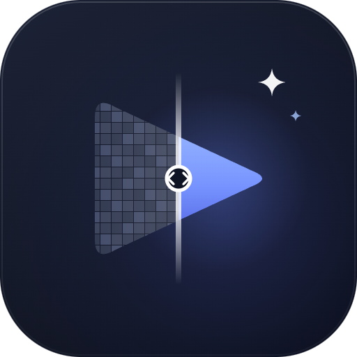
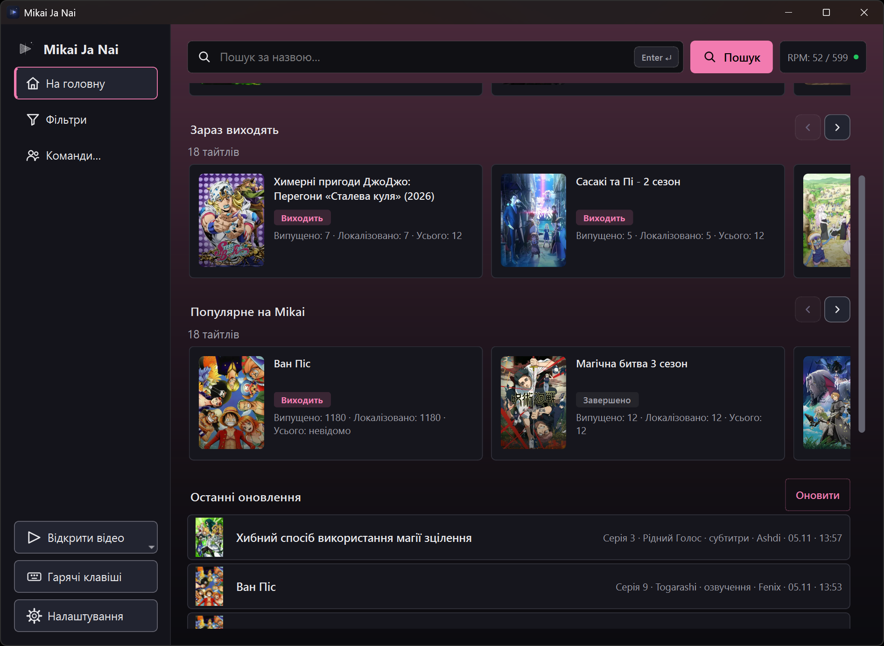
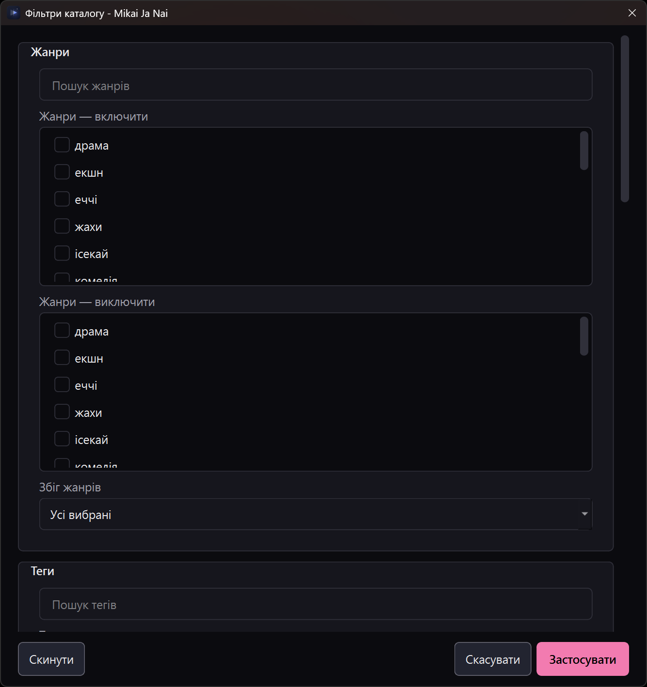
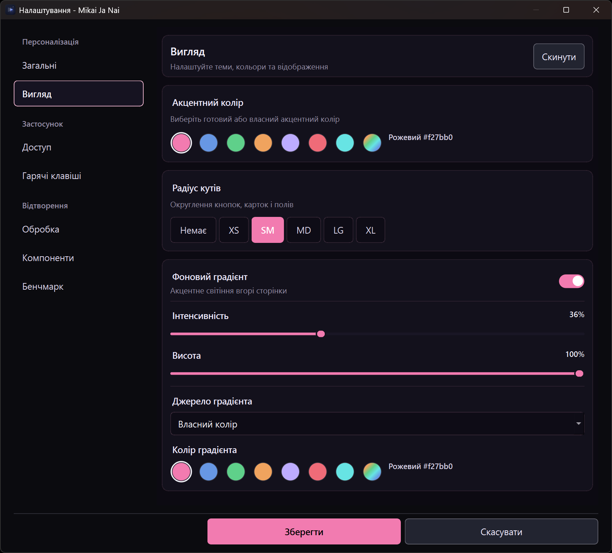
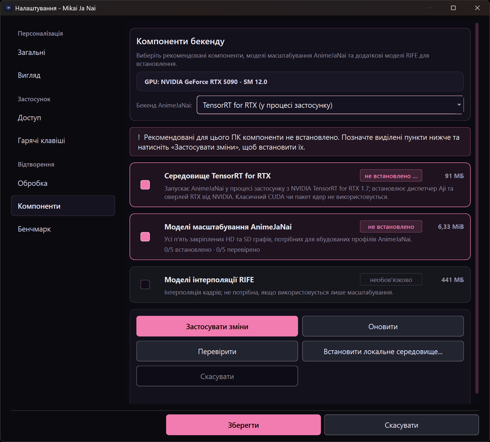
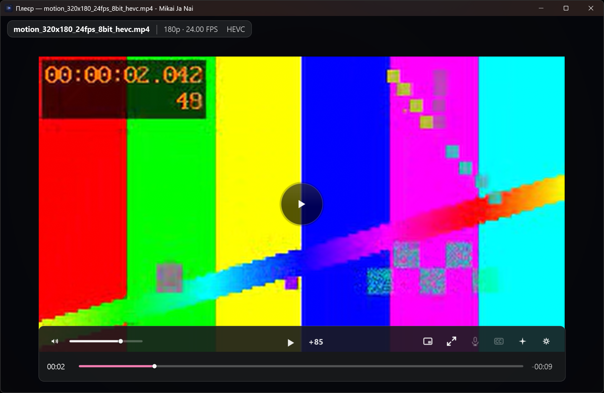
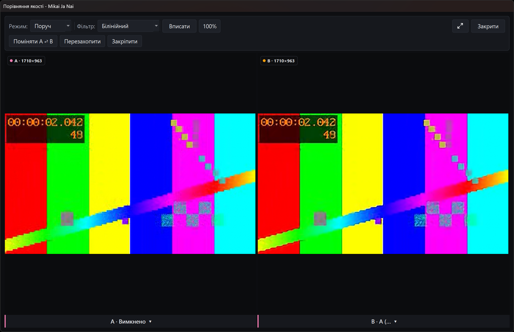

  

<h1 align="center">Mikai Ja Nai</h1>

An unofficial Mikai Ja Nai desktop client for the Mikai public anime catalogue API, with a local video player and optional video-processing tools.

  <a href="docs/user-guide.md">Quick start & catalogue</a> ·
  <a href="docs/player-guide.md">Player & Compare</a> ·
  <a href="docs/processing-guide.md">Processing & benchmarks</a> ·
  <a href="docs/settings-guide.md">Settings & privacy</a> ·
  <a href="docs/building.md">Build from source</a> ·
  <a href="docs/releasing.md">Packaging and release</a> ·
  <a href="docs/architecture.md">Architecture</a> ·
  <a href="CHANGELOG.md">Changelog</a> ·
  <a href="https://api.mikai.me/public/docs">Public API reference</a> ·
  <a href="CONTRIBUTING.md">Contributing</a> ·
  <a href="SECURITY.md">Security</a>

> Mikai Ja Nai is an independent, unofficial API client. It is not the Mikai service and is not affiliated with or endorsed by the service operators. Catalogue availability and provider playback depend on the upstream service.

## What it does

- Browse and search the Mikai catalogue, filter titles, view teams and schedules, and keep a local recently-opened list.
- Play provider streams or open local video files in an integrated **libmpv** player, through the picker, a drag-and-drop or an Open With hand-off. Local playback is independent of catalogue sign-in/API availability, and the app can offer itself as a per-user default-player candidate without changing an existing default on its own.
- Compare a paused frame across Original, Anime4K, AnimeJaNai and prepared Native candidates using true source replay, frame-stepping and difference metrics; export flicker comparisons as GIF, animated WebP or silent MP4.
- Cut a short video moment (MP4) from seekable media using an integrated filmstrip sheet bounded to ±2 minutes around the current frame, with an independent preview playhead, live audio preview, and stream-bitrate size estimates.
- Optionally acquire GPU-specific components and models for AI processing: the official AnimeJaNai v0.24.0 pair, and on Windows an opt-in TensorRT for RTX runtime. Ordinary Original playback does not require AI components; enhancement is opt-in.
- Skip the openings, endings and recaps the provider publishes for an episode, with accent-tinted timeline ranges and per-segment skip buttons.
- Preview the timeline on hover with decoded frame thumbnails, and move playback into a floating picture-in-picture window.
- Change how the picture fills the window: Fit, Fill, Stretch, 16:9, 4:3, original size, zoom, upscaler and downscaler.
- Load local subtitle files into local videos and network streams, search OpenSubtitles, inspect local media metadata, manage tracks, and customize the interface in English or Ukrainian.
- Resume where you stopped: playback starts at 00:00 and offers a stored position via an in-app themed prompt, the episode is marked watched at 90 % of its length, and the title page shows the same progress.
- Read the source at a glance in the player footer: HDR, Dolby Vision, Dolby Atmos and the video codec, based on what the container reports.
- Identify the exact binary you are running with `--version`, which prints the commit and build time without needing a desktop session.

## Screenshots

Application captures and their provenance are documented in [Screenshot provenance](docs/images/README.md).

<table>
  <tr>
    <td width="50%"></td>
    <td width="50%"></td>
  </tr>
  <tr>
    <td align="center"><em><strong>Catalogue.</strong> Sidebar, search, request quota, currently airing and latest updates.</em></td>
    <td align="center"><em><strong>Filters.</strong> Genre and tag include/exclude lists, years, format, status, season, studio and sort.</em></td>
  </tr>
  <tr>
    <td width="50%"></td>
    <td width="50%"></td>
  </tr>
  <tr>
    <td align="center"><em><strong>Appearance.</strong> Accent, corner radius and background gradient, applied to every surface at once.</em></td>
    <td align="center"><em><strong>Components.</strong> Optional runtime and model inventory; TensorRT for RTX is selected and its runtime is not installed.</em></td>
  </tr>
  <tr>
    <td width="50%"></td>
    <td width="50%"></td>
  </tr>
  <tr>
    <td align="center"><em><strong>Player.</strong> A local file paused mid-playback, with the real decode, timeline and transport chrome.</em></td>
    <td align="center"><em><strong>Compare.</strong> One captured frame, with the original and an Anime4K preset selected side by side.</em></td>
  </tr>
</table>

These manual Windows captures show the Ukrainian interface with a custom pink appearance. Player and Compare use a synthetic local video; Components shows TensorRT for RTX selected but not installed. Catalogue artwork and availability can change upstream. The images do not establish provider playback, AI inference, performance or release QA.

## Download and install

Builds are published at [github.com/smyhlin/Mikai-Ja-Nai/releases](https://github.com/smyhlin/Mikai-Ja-Nai/releases): a Windows portable ZIP and per-user setup, and four Linux formats — a dependency-based `tar.gz`, an `AppImage`, an Arch `pkg.tar.zst` and a Debian `.deb`.

Every release ships `SHA256SUMS`. Verify downloads against it before running them, and avoid unofficial mirrors.

The artifacts are unsigned, and [release status](docs/release-status.md) records what remains unverified — including the third-party source and redistribution obligations in [redistribution](docs/redistribution.md).

Linux packages include the project's libmpv runtime, but still require compatible host graphics, audio and system libraries. They are not universal Linux bundles. The original Windows v0.1.0 packages have a startup-runtime issue; the [player and usability update](https://github.com/smyhlin/Mikai-Ja-Nai/releases/tag/v0.1.0-update-20261101) includes the fix.

The latest published packages are for **v0.2.0**. The current source also contains later, unreleased changes; see the **Unreleased** section of the [changelog](CHANGELOG.md). Those changes are not in the v0.2.0 downloads. A new public release remains blocked by the third-party rights and release-verification gates in [release status](docs/release-status.md).

## Quick start

For Windows, the portable ZIP is extracted and launched from its own folder; the setup executable is per-user. On Linux, install the Arch or Debian package with the distribution's package manager, run the AppImage, or unpack the tarball anywhere. All four bring their own mpv runtime; the Arch package uses the distribution's Qt 6.12, the `.deb` and AppImage carry Qt 6.12 themselves, and the tarball expects a compatible host Qt.

See the [Linux packaging notes](docs/releasing.md#linux-x86_64) and [distribution packages](docs/releasing.md#distribution-packages-arch-debian). The API key is optional; it raises API rate limits and can be configured in **Settings → Application → Access**. Keep any key private.

To build from source, see [Building](docs/building.md). On first startup, the app can offer optional component setup; decline it to use ordinary playback.

Search the catalogue, open a title and select a provider episode, or choose **Open video** to play a local file. Choose an enhancement explicitly from the player's processing menu when the required runtime and models are installed.

## HDR playback verification

The player supports HDR-source-to-SDR playback policies (Auto, Stable and
Vivid); this is not a claim of native HDR display output.

Dedicated probe
instructions for natural footage, explicit natural-media mode, bounded scene
selection, fullscreen aging, strict fixture assertions and diagnostic-only
black-candidate interpretation are in the [fixture and probe guide](tests/fixtures/README.md).

Original-film evidence and captures remain external to the repository. See
[release status](docs/release-status.md) for the scoped verification and
publication hold.

## Platform support

The project has Windows x64 MinGW and Linux x86_64 build/package paths using Qt 6.12+, C++20 and desktop OpenGL. Linux can optionally deploy Qt and/or bundle a pinned private `libmpv`; otherwise the configured runtime uses host Qt and system `libmpv`.

These options do not establish broad distribution portability: host glibc/loader, graphics drivers and audio remain relevant, and graphics support varies by machine. Windows development uses the pinned mpv DEV archive containing headers/import library/`libmpv-2.dll`; the separate CLI/updater archive is not used or bundled.

The pinned DEV and Linux runtime archives are the 2026-10-24 builds; see [platform-specific build and runtime requirements](docs/building.md#platforms-and-prerequisites) for identities and the DEV-vs-CLI distinction.

TensorRT for RTX is a Windows-only opt-in: it needs a supported NVIDIA GPU and compatible driver, and its separately acquired runtime does not replace classic TensorRT. Upstream publishes no Linux RTX asset, so Linux builds keep classic TensorRT. The component and admission contracts are described under [optional enhancement paths](docs/architecture.md#optional-enhancement-paths).

## Credits and licensing

Mikai Ja Nai uses [mpv/libmpv](https://mpv.io/), [Anime4K](https://github.com/bloc97/Anime4K), [mpv-AnimeJaNai](https://github.com/the-database/mpv-AnimeJaNai), [animejanai-inference](https://github.com/the-database/animejanai-inference), Qt and other third-party components; these remain subject to their own terms. Its source is released under the [Unlicense](LICENSE), which does not relicense third-party code, models or runtime packages.

See [third-party notices and rights records](native/manifest/THIRD_PARTY_NOTICES.md) and the component manifests before redistributing a build.

The catalogue/API belongs to the Mikai service. This client is unofficial and does not claim ownership of service content or provider streams. More at [Mikai](https://mikai.me) and its [public API documentation](https://api.mikai.me/public/docs).

## More documentation

- [Quick start & catalogue](docs/user-guide.md): first launch, catalogue browsing and common workflows.
- [Player & Compare](docs/player-guide.md): playback controls, local media, track selection and frame comparison.
- [Processing & benchmarks](docs/processing-guide.md): optional processing components, models, profiles and benchmark reports.
- [Settings & privacy](docs/settings-guide.md): application settings, access credentials, customization and local data.
- [Building](docs/building.md): toolchains, dependencies, configure/build/test commands and runtime requirements.
- [Releasing](docs/releasing.md): local package creation, artifact contents, legal and publication limitations.
- [Architecture](docs/architecture.md): application layers, background work, playback/rendering, enhancement runtimes and data boundaries.
- [AnimeJaNai troubleshooting](docs/animejanai.md): the fork's filter admission contract and the failures it produces.
- [Public API v1 reference](https://api.mikai.me/public/docs); [benchmark evidence and limitations](bench_results.md); [Native build and bundle documentation](native/README.md) and [MSVC build guide](native/build-msvc.md).