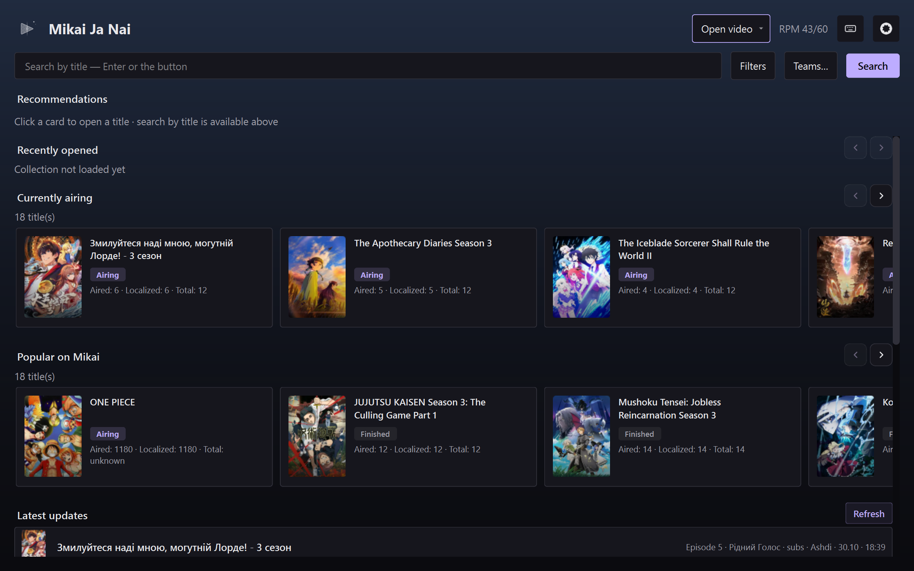
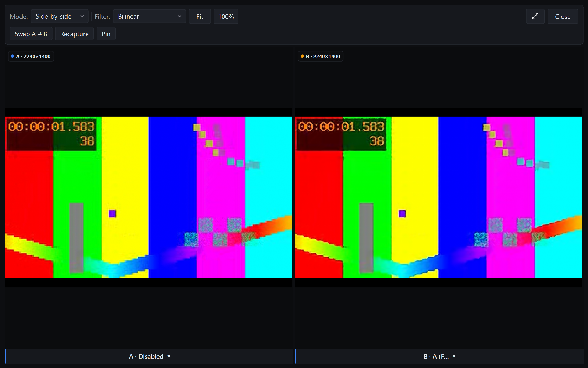
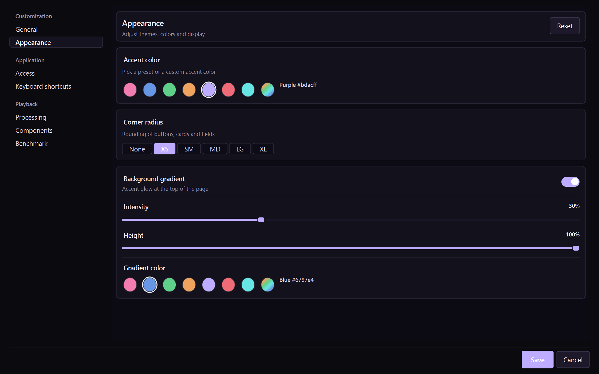
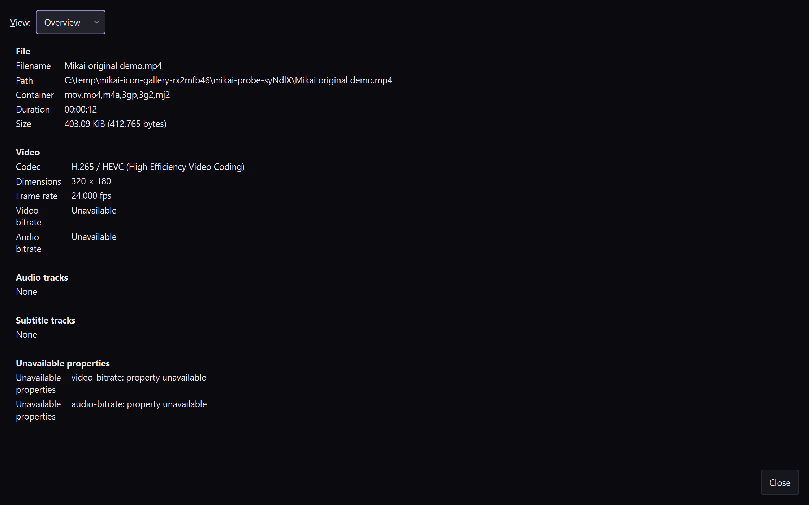

  

<h1 align="center">Mikai Ja Nai</h1>

An unofficial Mikai Ja Nai desktop client for the Mikai public anime catalogue API, with a local video player and optional video-processing tools.

  <a href="docs/user-guide.md">Quick start & catalogue</a> ·
  <a href="docs/player-guide.md">Player & Compare</a> ·
  <a href="docs/processing-guide.md">Processing & benchmarks</a> ·
  <a href="docs/settings-guide.md">Settings & privacy</a> ·
  <a href="docs/building.md">Build from source</a> ·
  <a href="docs/releasing.md">Packaging and release</a> ·
  <a href="docs/architecture.md">Architecture</a> ·
  <a href="CHANGELOG.md">Changelog</a> ·
  <a href="docs.md">Public API reference</a> ·
  <a href="CONTRIBUTING.md">Contributing</a> ·
  <a href="SECURITY.md">Security</a>

> Mikai Ja Nai is an independent, unofficial API client. It is not the Mikai service and is not affiliated with or endorsed by the service operators. Catalogue availability and provider playback depend on the upstream service.

## What it does

- Browse and search the Mikai catalogue, filter titles, view teams and schedules, and keep a local recently-opened list.
- Play provider streams or open local video files in an integrated **libmpv** player. Local playback is independent of catalogue sign-in/API availability.
- Compare a paused frame across Original, Anime4K, AnimeJaNai and prepared Native candidates; export a two-frame comparison GIF.
- Optionally acquire GPU-specific components and models for AI processing. Ordinary Original playback does not require AI components; enhancement is opt-in.
- Inspect local media metadata, manage audio/subtitle tracks, and customize the interface in English or Ukrainian.
- Resume where you stopped: playback starts at 00:00 and offers a stored position instead, the episode is marked watched at 90 % of its length, and the title page shows the same progress.
- Read the source at a glance in the player footer: HDR, Dolby Vision, Dolby Atmos and the video codec, based on what the container reports.
- Identify the exact binary you are running with `--version`, which prints the commit and build time without needing a desktop session.

## Screenshots

The README hero above uses the new full-color application icon; the current gallery below captures the matching application header, which uses a themed transparent monochrome icon.

<table>
  <tr>
    <td width="50%"></td>
    <td width="50%"></td>
  </tr>
  <tr>
    <td align="center"><em><strong>Catalogue.</strong> Search, filters, recommendations, currently airing, latest updates.</em></td>
    <td align="center"><em><strong>Compare.</strong> One pinned frame, original against a candidate chain, side by side or free.</em></td>
  </tr>
  <tr>
    <td width="50%"></td>
    <td width="50%"></td>
  </tr>
  <tr>
    <td align="center"><em><strong>Appearance.</strong> Accent, corner radius and gradient, applied to every surface at once.</em></td>
    <td align="center"><em><strong>Media information.</strong> What the container actually reports, track by track.</em></td>
  </tr>
</table>

These are unmodified full-resolution widget captures from the successful 2026-10-30 Windows run of the
opt-in `release_gallery_probe`, stored with the run's unmodified raw evidence in
[`docs/images/screenshots/`](docs/images/screenshots/). The probe recorded the live anonymous catalogue,
application/widget state and SHA-256 for each image. Its successful run finished at `2026-10-30T16:44:19Z`,
with no errors and workers drained cleanly. Its source video was the 12-second project-generated
FFmpeg `testsrc2` fixture (`tests/fixtures/generate_media.sh`); the operator-declared credit is recorded in
the evidence and is not independently verified. The separate 2026-10-24 historical run remains in
[`docs/images/gallery-release-0.1.0/`](docs/images/gallery-release-0.1.0/). These captures are real and not
AI-generated or composited; they do not imply sign-in, provider playback, AI inference, release QA, rights
clearance or approval for distribution. Live catalogue artwork, titles and availability belong to their
rights holders and change upstream — the layout is what is being shown, not a snapshot of catalogue contents.

The probe uses Original playback and non-AI comparison only: it never downloads models and never runs
inference. Regenerating the set needs an interactive desktop with working desktop OpenGL, an original
local video of at least eight seconds, the installed Standard mpv runtime module and network access to the
anonymous catalogue API. A headless software-GL display captures widgets but not the video surface, which
is why the player's picture is not in this table.

## Download and install

Builds are published at [github.com/smyhlin/Mikai-Ja-Nai/releases](https://github.com/smyhlin/Mikai-Ja-Nai/releases): a Windows portable ZIP and per-user setup, and four Linux formats — a dependency-based `tar.gz`, an `AppImage`, an Arch `pkg.tar.zst` and a Debian `.deb`.

Every release ships `SHA256SUMS`; verify an artifact with `sha256sum -c SHA256SUMS` before running it, and never take these binaries from an unofficial mirror.

The artifacts are unsigned, and [release status](docs/release-status.md) records what remains unverified — including the third-party source and redistribution obligations in [redistribution](docs/redistribution.md).

Every Linux artifact ships the project's own libmpv runtime — the fork the player and AnimeJaNai are built against, rebuilt with an FFmpeg TLS backend so https provider streams work. The tarball and AppImage keep it in `bin/mpv`, the Arch package in `/usr/lib/mikai/mpv`, and the `.deb` in `/usr/lib/mikai/mpv`; none needs or uses a distribution mpv. A developer build can still opt into `-DMIKAI_LINUX_BUNDLE_MPV=ON` to do the same.

Bundling does not remove the host glibc/loader, graphics-driver, EGL and audio requirements, and no format is a universal Linux package. The separate October 24 packages recorded in prior local evidence are historical baseline artifacts, not builds of the current changes.

Linux final-payload process smokes completed, including local video plus AAC; visual review of both playing captures confirmed a clear moving test pattern with no black or striped output. The final-source hour matrix completed with three PASS results and one unresolved Linux-stock black/frozen-output FAIL. The Windows setup is unsigned.

The v0.1.0 release is already published. Further public binary distribution remains on hold while the upstream source/license closure and release QA remain incomplete; the existing publication does not imply rights clearance or QA approval.

The published Windows v0.1.0 packages can fail at startup with a missing `__cxa_call_terminate` entry point. See [release status](docs/release-status.md) for the source fix and local package verification; a corrected public release is not claimed.

## Quick start

For Windows, the portable ZIP is extracted and launched from its own folder; the setup executable is per-user. On Linux, install the Arch or Debian package with the distribution's package manager, run the AppImage, or unpack the tarball anywhere. All four bring their own mpv runtime; the Arch package uses the distribution's Qt 6.12, the `.deb` and AppImage carry Qt 6.12 themselves, and the tarball expects a compatible host Qt.

See the [Linux packaging notes](docs/releasing.md#linux-x86_64) and [distribution packages](docs/releasing.md#distribution-packages-arch-debian). The API key is optional; it raises API rate limits and can be configured in **Settings → Application → Access**. Keep any key private.

To build from source, see [Building](docs/building.md). On first startup, the app can offer optional component setup; decline it to use ordinary playback.

Search the catalogue, open a title and select a provider episode, or choose **Open video** to play a local file. Choose an enhancement explicitly from the player's processing menu when the required runtime and models are installed.

## HDR playback verification

The player supports HDR-source-to-SDR playback policies (Auto, Stable and
Vivid); this is not a claim of native HDR display output.

Dedicated probe
instructions for natural footage, explicit natural-media mode, bounded scene
selection, fullscreen aging, strict fixture assertions and diagnostic-only
black-candidate interpretation are in the [fixture and probe guide](tests/fixtures/README.md).

Original-film evidence and captures remain external to the repository. See
[release status](docs/release-status.md) for the scoped verification and
publication hold.

## Platform support

The project has Windows x64 MinGW and Linux x86_64 build/package paths using Qt 6.12+, C++20 and desktop OpenGL. Linux can optionally deploy Qt and/or bundle a pinned private `libmpv`; otherwise the configured runtime uses host Qt and system `libmpv`.

These options do not establish broad distribution portability: host glibc/loader, graphics drivers and audio remain relevant, and graphics support varies by machine. Windows development uses the pinned mpv DEV archive containing headers/import library/`libmpv-2.dll`; the separate CLI/updater archive is not used or bundled.

The pinned DEV and Linux runtime archives are the 2026-10-24 builds; see [platform-specific build and runtime requirements](docs/building.md#platforms-and-prerequisites) for identities and the DEV-vs-CLI distinction.

## Credits and licensing

Mikai Ja Nai uses [mpv/libmpv](https://mpv.io/), [Anime4K](https://github.com/bloc97/Anime4K), [mpv-AnimeJaNai](https://github.com/the-database/mpv-AnimeJaNai), [animejanai-inference](https://github.com/the-database/animejanai-inference), Qt and other third-party components; these remain subject to their own terms. Its source is released under the [Unlicense](LICENSE), which does not relicense third-party code, models or runtime packages.

See [third-party notices and rights records](native/manifest/THIRD_PARTY_NOTICES.md) and the component manifests before redistributing a build.

The catalogue/API belongs to the Mikai service. This client is unofficial and does not claim ownership of service content or provider streams. More at [Mikai](https://mikai.me) and its [public API documentation](https://api.mikai.me/public/docs).

## More documentation

- [Quick start & catalogue](docs/user-guide.md): first launch, catalogue browsing and common workflows.
- [Player & Compare](docs/player-guide.md): playback controls, local media, track selection and frame comparison.
- [Processing & benchmarks](docs/processing-guide.md): optional processing components, models, profiles and benchmark reports.
- [Settings & privacy](docs/settings-guide.md): application settings, access credentials, customization and local data.
- [Building](docs/building.md): toolchains, dependencies, configure/build/test commands and runtime requirements.
- [Releasing](docs/releasing.md): local package creation, artifact contents, legal and publication limitations.
- [Architecture](docs/architecture.md): application layers, playback/rendering and data boundaries.
- [Public API v1 reference](docs.md); [benchmark evidence and limitations](bench_results.md); [Native build and bundle documentation](native/README.md) and [MSVC build guide](native/build-msvc.md).