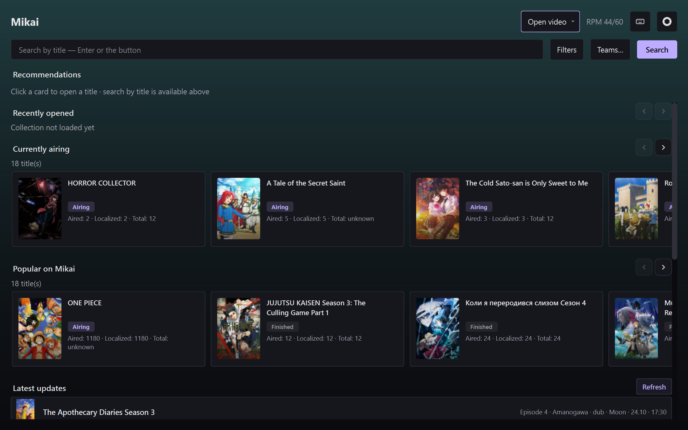
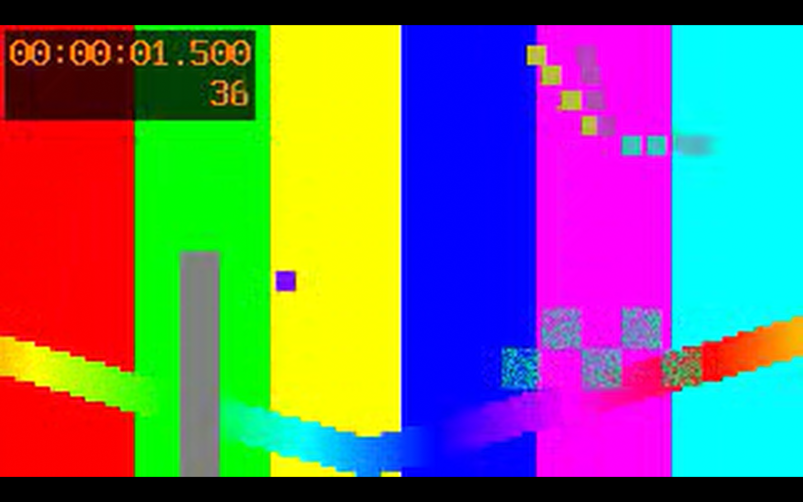
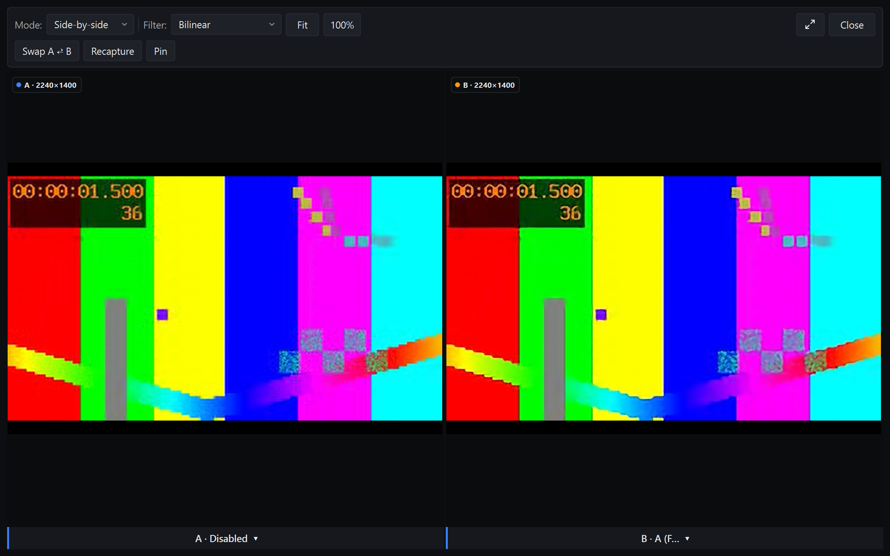
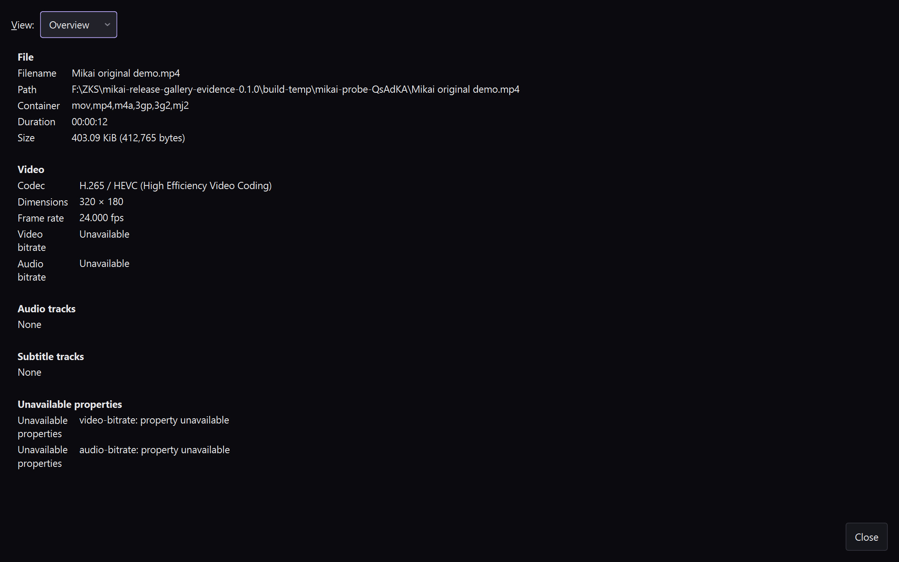
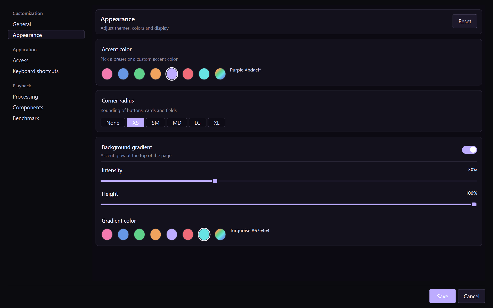

  

<h1 align="center">Mikai</h1>

An unofficial desktop client for the Mikai public anime catalogue API, with a local video player and optional video-processing tools.

  <a href="docs/user-guide.md">User guide</a> ·
  <a href="docs/building.md">Build from source</a> ·
  <a href="docs/releasing.md">Packaging and release</a> ·
  <a href="docs/architecture.md">Architecture</a> ·
  <a href="CHANGELOG.md">Changelog</a> ·
  <a href="docs.md">Public API reference</a> ·
  <a href="CONTRIBUTING.md">Contributing</a> ·
  <a href="SECURITY.md">Security</a>

> Mikai is an independent, unofficial API client. It is not the Mikai service and is not affiliated with or endorsed by the service operators. Catalogue availability and provider playback depend on the upstream service.

## What it does

- Browse and search the Mikai catalogue, filter titles, view teams and schedules, and keep a local recently-opened list.
- Play provider streams or open local video files in an integrated **libmpv** player. Local playback is independent of catalogue sign-in/API availability.
- Compare a paused frame across Original, Anime4K, AnimeJaNai and prepared Native candidates; export a two-frame comparison GIF.
- Optionally acquire GPU-specific components and models for AI processing. Ordinary Original playback does not require AI components; enhancement is opt-in.
- Inspect local media metadata, manage audio/subtitle tracks, and customize the interface in English or Ukrainian.

## Gallery

These are actual widget captures from a successful isolated desktop run (1280×800 logical; 2240×1400 pixels at the captured 1.75 device-pixel ratio). The catalogue was loaded anonymously from the live public API. The local video is a project-generated FFmpeg `lavfi` test pattern—not sourced footage—and is credited in the [run evidence](docs/images/gallery-release-0.1.0/gallery-evidence.json) and [fixture provenance](tests/fixtures/README.md). The probe used Original playback and non-AI comparison; it did not acquire models or run AI inference. Live catalogue artwork belongs to its respective rights holders and may change upstream. See the [capture procedure and provenance requirements](docs/images/README.md).

  
  

<strong>Live catalogue.</strong> Anonymous current-airing and popular titles with real service artwork. &nbsp; <strong>Original player.</strong> The generated 12-second, 320×180 video-only fixture is shown unprocessed; it contains no third-party footage or audio.

  
  

<strong>Compare.</strong> One paused frame compared as Original (`off`) and the available `fast_a` shader candidate; this is not a quality or speed benchmark. &nbsp; <strong>Media information.</strong> Actual metadata identifies H.265, 320×180, 24 fps and 12 seconds, with no audio or subtitle tracks.

  

<strong>Appearance settings.</strong> Real controls were exercised in three rounds; the saved preferences were not changed. Supporting before/preview/reset captures and interaction evidence are in <a href="docs/images/gallery-release-0.1.0/gallery-evidence.json">the successful evidence record</a>.

See [release status](docs/release-status.md) for the exercised platform checks, exact local artifact identities and remaining distribution limits.

## Download and install

There is no public download URL configured in this source checkout. Do not download binaries from an unofficial mirror. Private Windows portable/setup and Linux archive QA packages from the current HDR/frame-timing source are recorded with their exact local paths and hashes in [release status](docs/release-status.md); they are not public downloads, and no package is approved for publication. Linux packaging can independently opt into Qt deployment and the pinned private `libmpv` bundle; without those options it uses host Qt and system `libmpv`. Bundling either does not remove the host glibc/loader, graphics-driver and audio requirements, and the bundled-mpv profile is not a universal Linux package. The separate October 24 packages in release status are historical baseline artifacts, not builds of the current changes. Linux final-payload process smokes completed, including local video plus AAC; visual review of both playing captures confirmed a clear moving test pattern with no black or striped output. The final-source hour matrix completed with three PASS results and one unresolved Linux-stock black/frozen-output FAIL; the Windows setup is unsigned. Public binary distribution remains on hold while the upstream source/license closure is incomplete.

## Quick start

For Windows, the portable ZIP is extracted and launched from its own folder; the setup executable is per-user. Linux runtime dependencies depend on the selected package profile; see its [installation notes](docs/releasing.md#linux-x86_64). The API key is optional; it raises API rate limits and can be configured in **Settings → General**. Keep any key private.

To build from source, see [Building](docs/building.md). On first startup, the app can offer optional component setup; decline it to use ordinary playback. Search the catalogue, open a title and select a provider episode, or choose **Open video** to play a local file. Choose an enhancement explicitly from the player's processing menu when the required runtime and models are installed.

## HDR playback verification

The player supports HDR-source-to-SDR playback policies (Auto, Stable and
Vivid); this is not a claim of native HDR display output. Dedicated probe
instructions for natural footage, explicit natural-media mode, bounded scene
selection, fullscreen aging, strict fixture assertions and diagnostic-only
black-candidate interpretation are in the [fixture and probe guide](tests/fixtures/README.md).
Original-film evidence and captures remain external to the repository. See
[release status](docs/release-status.md) for the scoped verification and
publication hold.

## Platform support

The project has Windows x64 MinGW and Linux x86_64 build/package paths using Qt 6.12+, C++20 and desktop OpenGL. Linux can optionally deploy Qt and/or bundle a pinned private `libmpv`; otherwise the configured runtime uses host Qt and system `libmpv`. These options do not establish broad distribution portability: host glibc/loader, graphics drivers and audio remain relevant, and graphics support varies by machine. Windows development uses a pinned mpv DEV archive containing headers/import library/DLL; the separate mpv CLI/updater archive is not used. See [platform-specific build and runtime requirements](docs/building.md#platforms-and-prerequisites).

## Credits and licensing

Mikai uses [mpv/libmpv](https://mpv.io/), [Anime4K](https://github.com/bloc97/Anime4K), [mpv-AnimeJaNai](https://github.com/the-database/mpv-AnimeJaNai), [animejanai-inference](https://github.com/the-database/animejanai-inference), Qt and other third-party components; these remain subject to their own terms. Mikai's source is released under the [Unlicense](LICENSE), which does not relicense third-party code, models or runtime packages. See [third-party notices and rights records](native/manifest/THIRD_PARTY_NOTICES.md) and the component manifests before redistributing a build.

The catalogue/API belongs to the Mikai service. This client is unofficial and does not claim ownership of service content or provider streams. More at [Mikai](https://mikai.me) and its [public API documentation](https://api.mikai.me/public/docs).

## More documentation

- [User guide](docs/user-guide.md): catalogue, playback, settings, components, models and benchmark reports.
- [Building](docs/building.md): toolchains, dependencies, configure/build/test commands and runtime requirements.
- [Releasing](docs/releasing.md): local package creation, artifact contents, legal and publication limitations.
- [Architecture](docs/architecture.md): application layers, playback/rendering and data boundaries.
- [Public API v1 reference](docs.md); [benchmark evidence and limitations](bench_results.md); [Native build and bundle documentation](native/README.md) and [MSVC build guide](native/build-msvc.md).